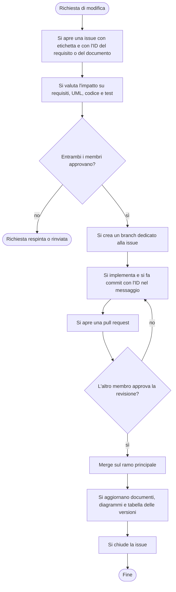

# MPlan – Gestione del progetto

**Documento 2 – Gestione del progetto** (Software Life Cycle, Configuration Management, Persone e organizzazione del team)
Corso di Ingegneria del Software, A.A. 2026/27

| Versione | Data | Modifiche |
|---|---|---|
| 0.1.0 | 15/10/2026 | Versione iniziale |
| 0.1.1 | 17/10/2026 | Aggiornamento rispetto al Project Plan, alla specifica dei requisiti e al modo di lavorare sulle issue |

> **Stato:** bozza. I punti segnati **[DA COMPLETARE]** richiedono dati che il team deve ancora inserire.

---

## Indice

1. Introduzione
2. Ciclo di vita del software
3. Configuration management
4. Persone e organizzazione del team

---

## 1. Introduzione

Questo documento descrive come il team gestisce lo sviluppo di **MPlan**: il processo seguito, gli strumenti con cui si tiene sotto controllo il codice e i documenti, e l'organizzazione del lavoro tra le persone.

Descrive il processo **effettivamente seguito**. Le differenze rispetto a quanto previsto nel Project Plan (Documento 1) sono indicate in 2.6.

---

## 2. Ciclo di vita del software

### 2.1 Processo seguito

Il team segue un approccio agile ispirato a **Scrum**, adattato a un gruppo di due persone, con iterazioni settimanali e rilascio incrementale (Project Plan, sezione 2.1). Il lavoro è diviso in **sprint** di una settimana, da un giovedì al giovedì successivo. Il giovedì il team si incontra di persona per pianificare lo sprint, fare il punto della situazione e iniziare il lavoro. All'inizio di ogni sprint ogni membro prende uno o più compiti come responsabile, e al termine di ogni compito il lavoro è rivisto dall'altro membro. Su ogni compito possono comunque lavorare entrambi, ad esempio con consigli o piccole modifiche (3.2).

### 2.2 Ruoli ed eventi di Scrum

| Ruolo | Chi | Compito |
|---|---|---|
| Product Owner / Customer Representative | Matteo Poli | Rappresenta le esigenze del committente (MP elettrica s.a.s.), decide le priorità dei compiti e dei requisiti |
| Scrum Master / Agile Coordinator | Michele Bisignano | Cura il rispetto del processo, gestisce la board Kanban e rimuove gli ostacoli |
| Sviluppatori | Entrambi i membri | Svolgono i compiti dello sprint |

| Evento o artefatto di Scrum | Come lo svolgiamo |
|---|---|
| Sprint planning | Ogni giovedì, nella sessione congiunta di tre ore (Project Plan, 2.2), si scelgono i compiti dello sprint e si assegnano le issue ai membri |
| Daily scrum | Allineamento quotidiano di 15 minuti, dalle 10:15 alle 10:30, compatibilmente con gli impegni accademici (Project Plan, 2.2) **[DA COMPLETARE: confermare che si svolge così]** |
| Sprint review | Ogni giovedì si fa il punto sul lavoro svolto; inoltre ogni compito è rivisto dall'altro membro con la pull request prima del merge (3.2) |
| Sprint retrospective | Svolta nella sessione del giovedì (Project Plan, 2.2) **[DA COMPLETARE: confermare]** |
| Product backlog | Le issue della kanban board non ancora assegnate a uno sprint, ciascuna con gli ID dei requisiti che realizza. L'ordine segue le priorità MoSCoW della specifica dei requisiti (sezione 6) |
| Sprint backlog | Le issue assegnate ai membri nello sprint (3.2) |

### 2.3 Sprint e milestone

| Sprint | Periodo | Compiti | Responsabile |
|---|---|---|---|
| Sprint 1 | 08/10/2026 – 15/10/2026 | Diagramma UML dei casi d'uso | Scrum Master |
| | | Specifica dei requisiti (Documento 3) | Product Owner |
| Sprint 2 | 15/10/2026 – 22/10/2026 | Project Plan (Documento 1) | Scrum Master |
| | | Gestione del progetto (Documento 2, questo documento) | Product Owner |

| Milestone | Scadenza | Contenuto (Project Plan, 2.3) | Stato |
|---|---|---|---|
| M0 – Setup del repository | 08/10/2026 | Creazione e configurazione del repository GitHub | **[DA COMPLETARE: chiusa?]** |
| M1 – Ingegneria dei requisiti | 22/10/2026 | Specifica dei requisiti pubblicata nel repository | In corso |
| M2–M6 | Vedi Project Plan | Design, sviluppo del codice, test, manutenzione, revisione dei documenti e consegna | – |

La specifica dei requisiti comprende il diagramma dei casi d'uso. Nello stesso periodo si producono anche il Project Plan e questo documento, che il Project Plan non assegna a una milestone (vedi 2.6).

### 2.4 Gestione di una modifica

Ogni modifica, che nasca da un commento di revisione o da una decisione del team, segue la procedura del Project Plan (sezione 12): issue con etichetta, valutazione dell'impatto, approvazione di entrambi i membri, implementazione con pull request, aggiornamento dei documenti e chiusura della issue. La regola sull'ID del requisito è quella della specifica dei requisiti (sezione 1.7).

*Figura 2.1 – Schema provvisorio della gestione di una modifica. La versione definitiva sarà un diagramma delle attività in StarUML.*

### 2.5 Approccio basato su modelli (MDA)

Il design parte dai diagrammi UML realizzati con StarUML. Dal diagramma delle classi si genera una prima versione del codice Java, poi completata a mano. Le classi generate e quelle modificate saranno indicate nella relazione **[DA COMPLETARE alla fase di implementazione]**.

### 2.6 Differenze rispetto al Project Plan

Il Project Plan (versione 0.1.1 del 17/10/2026) è una bozza. Rispetto a esso il processo seguito differisce nei punti seguenti; la tabella va aggiornata a ogni revisione del piano.

| Aspetto | Project Plan | Processo seguito |
|---|---|---|
| Messaggi di commit | Nessuna convenzione indicata | Formato `tipo: testo`, con l'ID del requisito dal 15/10/2026 (3.4) |
| Lavoro sulle issue | Le attività sono assegnate tramite issue, con revisione dell'altro membro (2.2, 4.2) | Una persona è responsabile della issue e l'altro membro la rivede, ma entrambi possono contribuire con consigli o piccole modifiche (3.2) |
| Controlli prima del merge | Compilazione e test prima del merge (4.2) | Per ora solo la revisione dell'altro membro, perché non c'è ancora codice **[DA COMPLETARE: indicare se si useranno controlli automatici]** |
| Contenuto di M1 | Specifica dei requisiti | Nello stesso periodo si producono anche Project Plan e Documento 2 (2.3) |
| Daily scrum | 15 minuti ogni giorno (2.2) | **[DA COMPLETARE: come si svolge davvero]** |
| Approvazione del Project Plan | Non indicata | Richiesta al docente con una issue a lui assegnata, come chiede il regolamento (3.6) |

---

## 3. Configuration management

### 3.1 Strumenti

| Strumento | Uso |
|---|---|
| Git e GitHub | Versionamento del codice e dei documenti, issue, branch, pull request, revisioni e milestone |
| GitHub Projects | Kanban board per la gestione dei compiti dello sprint e del product backlog (Project Plan, 2.1) **[DA COMPLETARE: colonne della board]** |
| StarUML | Modelli UML; il file di progetto è nel repository |
| Eclipse e Maven | Sviluppo e gestione delle dipendenze |

Il repository è condiviso con il docente e con l'esercitatrice (account `garganti` e `silviabonfanti`) **[DA COMPLETARE: verificare]**.

### 3.2 Flusso di lavoro

1. **Una issue per compito.** Ogni compito della settimana è una issue assegnata a una persona, che ne è la responsabile, collegata a una milestone e con un'etichetta di tipo (`documento`, `codice` o `test`). Anche l'altro membro può lavorare sulla stessa issue, con consigli o piccole modifiche; la responsabilità resta di una persona sola.
2. **Un branch per issue.** Il nome del branch inizia con il numero della issue, seguito da un nome breve (ad esempio `12-nome-del-branch`). Una persona può avere più issue, quindi più branch attivi contemporaneamente.
3. **Commit.** Il lavoro è salvato con commit sul branch della issue. L'altro membro può aggiungere commit allo stesso branch per piccole correzioni, concordandole con il responsabile.
4. **Pull request.** Al termine del compito si apre una pull request verso il ramo principale.
5. **Revisione.** L'altro membro del team, cioè chi non è responsabile della issue, rivede la pull request. Se servono correzioni, si tornano a fare commit sullo stesso branch.
6. **Merge e chiusura.** Dopo l'approvazione la pull request è unita al ramo principale e la issue è chiusa.

Lo stato di ciascun requisito (proposto, validato, implementato, verificato) è tracciato nelle issue, come previsto dalla specifica dei requisiti (sezione 1.7).

Il ramo principale `main` è protetto: non si fa push diretto e ogni modifica entra con una pull request approvata dall'altro membro. **[DA COMPLETARE:** verificare dopo aver attivato la protezione e indicare il tipo di merge usato.**]**

### 3.3 Comandi usati

| Operazione | Comando |
|---|---|
| Aggiornare il ramo principale | `git pull` |
| Creare il branch di una issue | `git switch -c <numero>-<nome-del-branch>` |
| Preparare e salvare le modifiche | `git add <file>` e `git commit -m "<messaggio con ID>"` |
| Pubblicare il branch | `git push -u origin <branch>` |
| Rivedere, approvare e unire | pull request su GitHub |

### 3.4 Regole sul repository

- Codice e documenti sono in cartelle separate (`code/` e `docs/`).
- Il `.gitignore` esclude i file generati ma non il file `.project`.
- Il messaggio di commit ha la forma `tipo: testo` (ad esempio `docs: …` per i documenti) e riporta l'ID del requisito o del documento a cui si riferisce, come previsto dalla specifica dei requisiti (sezione 1.7). Esempio: `docs: chiarisce le transizioni di stato (FUN.6.3)`. La regola sull'ID è applicata dal 15/10/2026; i commit precedenti usano solo il formato `tipo: testo`.
- Le versioni significative sono identificate con tag Git; la release finale avrà il tag `v1.0.0` (Project Plan, 13.1).

### 3.5 Statistiche

| Dato | Valore |
|---|---|
| Commit per membro | **[DA COMPLETARE]** |
| Issue aperte / chiuse | **[DA COMPLETARE]** |
| Pull request aperte / unite | **[DA COMPLETARE]** |
| Revisioni svolte per membro | **[DA COMPLETARE]** |

### 3.6 Comunicazioni con il docente

Le richieste al docente si fanno con una issue a lui assegnata (account `garganti`), come previsto dal regolamento: ad esempio l'approvazione del Project Plan, che va condiviso almeno un mese prima dell'esame. **[DA COMPLETARE:** aprire la issue di approvazione del Project Plan.**]**

---

## 4. Persone e organizzazione del team

### 4.1 Il team

| Membro | Ruolo in Scrum | Ruolo di sviluppo | Attività svolte finora |
|---|---|---|---|
| Matteo Poli | Product Owner / Customer Representative | Sviluppatore | Specifica dei requisiti; gestione del progetto |
| Michele Bisignano | Scrum Master / Agile Coordinator | Sviluppatore | Diagramma UML dei casi d'uso; Project Plan |

### 4.2 Schema organizzativo

Il team è composto da due persone con responsabilità condivise: ogni compito ha un solo responsabile ed è sempre rivisto dall'altro membro, ma entrambi possono contribuire alla stessa issue. I ruoli organizzativi sono adattati alle dimensioni ridotte del team e non implicano una separazione rigida delle responsabilità (Project Plan, 3.2). **[DA COMPLETARE:** indicare lo schema di organizzazione del team presentato nel libro (capitolo 5) a cui ci si rifà e perché è adatto a un team di due persone.**]**

### 4.3 Ripartizione del lavoro

Ogni sprint il lavoro si divide in compiti individuali, ciascuno con la propria issue. Un membro può svolgere più compiti nello stesso sprint, e l'altro può dare consigli o fare piccole modifiche su ciascuno. Le attività svolte sono quelle della tabella in 2.3.

### 4.4 Comunicazione

Il team si incontra di persona ogni giovedì (2.1) e prevede un allineamento quotidiano di 15 minuti (2.2). **[DA COMPLETARE:** altri canali usati tra un incontro e l'altro, ad esempio messaggi o commenti nelle issue.**]**
