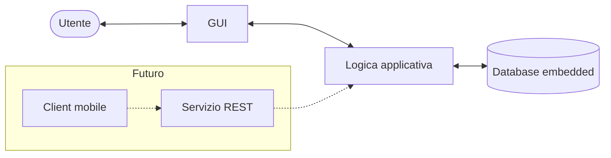
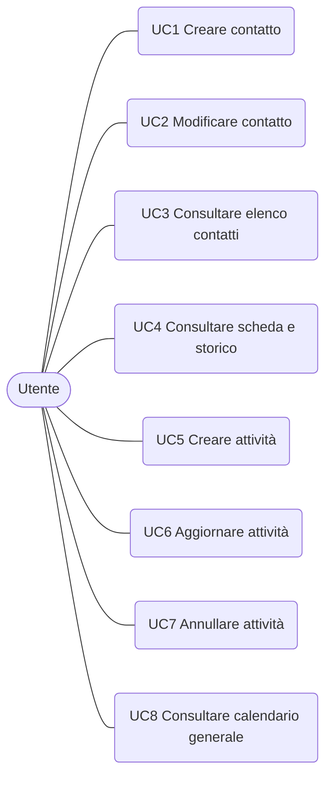
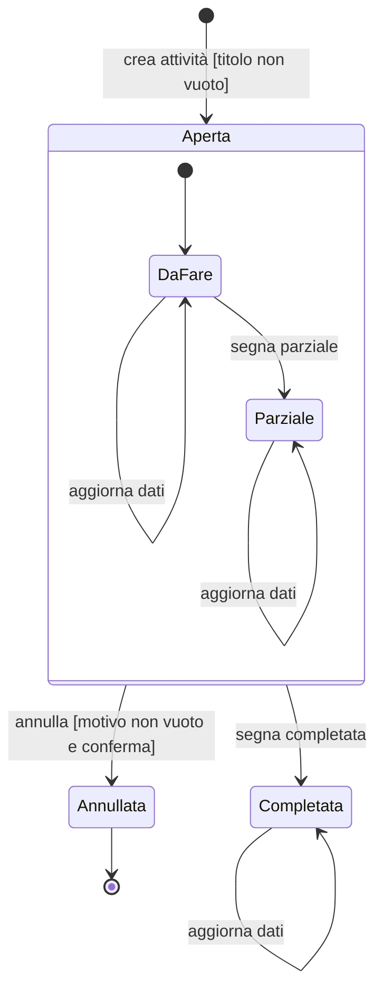
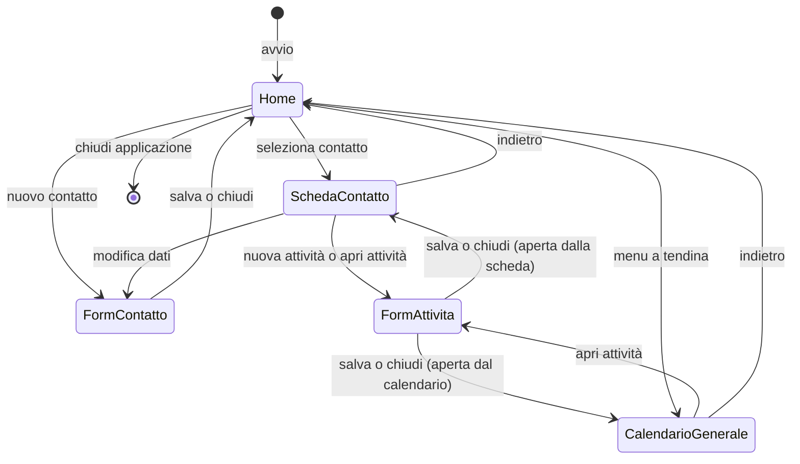

# MPlan – Specifica dei requisiti software

**Documento 3 – Requisiti** (Requirements Engineering e Software Quality)
Corso di Ingegneria del Software, A.A. 2026/27

| Versione | Data | Modifiche |
|---|---|---|
| 0.1.0 | 11/10/2026 | Versione iniziale |
| 0.1.1 | 12/10/2026 | Miglioramento della formattazione |


> **Stato:** da validare con il cliente e con il team. I requisiti contrassegnati con † o ‡ (vedi 1.6) derivano da informazioni parziali o non confermate dal cliente e potrebbero cambiare.

---

## Indice

1. Introduzione
2. Elicitazione dei requisiti
3. Descrizione generale
4. Casi d'uso
5. Requisiti specifici
   - 5.1 Requisiti funzionali (FUN)
   - 5.2 Requisiti sui dati (DAT)
   - 5.3 Requisiti della GUI (GUI)
   - 5.4 Requisiti sulle interfacce (INT)
   - 5.5 Requisiti non funzionali (NFR)
   - 5.6 Vincoli (VIN)
6. Priorità dei requisiti (MoSCoW)
7. Requisiti futuri e fuori scope
8. Modelli di comportamento (diagrammi di stato)
9. Tracciabilità
10. Qualità del software
11. Punti aperti

---

## 1. Introduzione

### 1.1 Scopo del documento

Questo documento specifica i requisiti del software **MPlan**, in forma ispirata allo standard IEEE 830 (distinzione tra requisiti funzionali, di interfaccia, non funzionali e vincoli di progetto) e con il formato dei requisiti del documento di riferimento fornito dal docente (*[Mechanical Lung Ventilator – Software Requirements Specification](https://github.com/foselab/abz2024_casestudy_MLV/blob/main/Mechanical_Lung_Ventilator%201_5.pdf)*). Si rivolge al team di sviluppo, al docente e al cliente.

### 1.2 Ambito del prodotto

MPlan è un'applicazione per tenere traccia dei **clienti e dei cantieri** di MP Elettric S.a.s., società che svolge interventi elettrici presso terzi, e di tutte le **attività** svolte per ciascuno di essi. Permette di registrare cosa è stato fatto, cosa resta da fare e quali materiali servono per le visite successive, di consultare lo storico per contatto e di visualizzare un calendario generale delle attività.

**Rientra nella prima versione (v1):**
- anagrafica di clienti e cantieri;
- creazione, aggiornamento e annullamento delle attività, con note sui materiali in testo libero;
- storico per contatto, calendario del contatto e calendario generale;
- salvataggio persistente in un database embedded locale;
- funzionamento su PC (Windows), mono-utente e senza accesso.

**Non rientra nella v1** (vedi sezione 7): gestione di magazzino, giacenze, soglie minime e costi dei materiali; utenti multipli, ruoli e utente master; versione mobile; accesso da più dispositivi; autenticazione.

| ID | Obiettivo | Fonte | Requisiti |
|---|---|---|---|
| OB.1 | Sapere per ogni cliente cosa è stato fatto e cosa resta | D1.2 | FUN.4, FUN.5.1, FUN.6, FUN.8, FUN.9, FUN.10 |
| OB.2 | Riassumere il lavoro della giornata | D1.2 | FUN.11, FUN.11.1, GUI.7 |
| OB.3 | Preparare i materiali per il giorno dopo | D1.2, D4.2† | FUN.8, FUN.8.1, FUN.8.2 |
| OB.4 | Ritrovare a fine mese gli interventi per la fatturazione | D1.2, D5.2 | FUN.1.1, FUN.9, FUN.9.1, FUN.10.1, GUI.4 |

### 1.3 Definizioni e abbreviazioni

| Termine | Definizione |
|---|---|
| Contatto | Voce dell'anagrafica: un cliente (privato o azienda) oppure un cantiere. Clienti e cantieri sono salvati nella stessa lista |
| Cliente | Persona o azienda per cui si svolgono interventi |
| Cantiere | Luogo o lavoro, anche prolungato nel tempo, trattato come un contatto |
| Attività (o intervento) | Lavoro svolto o da svolgere presso un contatto in una data, con titolo, descrizione e note |
| Titolo | Descrizione breve (poche parole) di cosa c'è da fare |
| Descrizione | Testo, compilato dopo l'intervento, su ciò che è stato fatto |
| Note | Testo libero su ciò che manca o serve per la visita successiva, inclusi i materiali |
| Stato | Condizione di un'attività: da fare, parziale, completata, annullata |
| Annullamento | Marcatura di un'attività come annullata, con un motivo, senza eliminarla dallo storico |
| Storico | Elenco di tutte le attività di un contatto |
| Scheda contatto | Schermata con i dati principali di un contatto e il suo storico in forma di calendario |
| Calendario generale | Vista del calendario con le attività di tutti i contatti |
| Home | Schermata iniziale, con l'elenco di tutti i contatti e il menu per aprire il calendario generale |
| Registro delle modifiche | Elenco delle modifiche e degli annullamenti delle attività, con data, tipo e motivo |
| Slot | Durata indicativa di un'attività: mezza giornata o giornata intera |
| CF / P.IVA | Codice fiscale / Partita IVA |
| GUI | Interfaccia grafica dell'applicazione |
| v1 | Prima versione, oggetto di questa specifica |
| MoSCoW | Tecnica di priorità: Must, Should, Could, Won't |

### 1.4 Riferimenti

- [*Requisiti per il progetto di ingegneria del software, A.A. 2026/27*, v1.0.0 (A. Gargantini, S. Bonfanti)](../reference/requisiti_progetto.pdf).
- [S. Bonfanti, A. Gargantini, *Mechanical Lung Ventilator – Software Requirements Specification, v1.5, dicembre 2023](https://github.com/foselab/abz2024_casestudy_MLV/blob/main/Mechanical_Lung_Ventilator%201_5.pdf)* (documento di riferimento per lo schema).
- IEEE Std 830-1998, *Recommended Practice for Software Requirements Specifications*.
- Intervista di elicitazione del 08/10/2026: [intervista-01-domande-risposte.md](../client/intervista-01-domande-risposte.md), [intervista-01-riassunto-esigenze-cliente.md](../client/intervista-01-riassunto-esigenze-cliente.md) e [BozzaInterfacciaCliente](../client/BozzaInterfacciaCliente.jpeg).

### 1.5 Struttura del documento

- La **sezione 2** descrive come sono stati raccolti i requisiti.
- La **sezione 3** presenta il prodotto, gli utenti, i vincoli e le assunzioni.
- La **sezione 4** elenca i casi d'uso.
- La **sezione 5** contiene i requisiti specifici, divisi per tipo in tabelle.
- Le sezioni **6 e 7** riportano le priorità e ciò che è rimandato o escluso.
- La **sezione 8** presenta i diagrammi di stato, la **9** la tracciabilità, la **10** la qualità e la **11** i punti ancora aperti.

Il formato dei requisiti (identificatori, rationale e riferimento di origine, tabelle per tipo) segue il documento di riferimento del docente, mentre l'ordine delle sezioni è adattato al progetto. Le sezioni 2 (elicitazione) e 4 (casi d'uso) sono aggiunte rispetto allo standard IEEE 830, di cui il documento mantiene i contenuti:

| Sezione di IEEE 830 | Dove in questo documento |
|---|---|
| 1 – Introduzione (scopo, ambito, definizioni, riferimenti, panoramica) | 1.1–1.5 |
| 2 – Descrizione generale (prospettiva, funzioni, utenti, vincoli, assunzioni, ripartizione dei requisiti) | 3.1–3.6 |
| 3.1 – Interfacce esterne (utente, hardware, software, comunicazione) | 5.3 (GUI) e 5.4 (INT) |
| 3.2 – Requisiti funzionali | 5.1 (FUN) e sezione 4 |
| 3.3 – Requisiti di prestazione | 5.5 (NFR.3) |
| 3.4 – Requisiti sui dati | 5.2 (DAT) |
| 3.5 – Vincoli di progetto | 5.6 (VIN) |
| 3.6 – Attributi del sistema (affidabilità, sicurezza, manutenibilità, portabilità) | 5.5 (NFR) e sezione 10 |
| 3.7 – Organizzazione dei requisiti e priorità | sezione 5 (per tipo) e sezione 6 (MoSCoW) |
| Tracciabilità e appendici | sezioni 9 e 11 |

Come richiesto dallo standard, i requisiti sono identificati in modo univoco, classificati per importanza (sezione 6) e per stabilità (simboli † e ‡), tracciabili (sezione 9) e, dove possibile, verificabili (sezione 10).

### 1.6 Convenzioni

**Numerazione dei requisiti.** Come nel documento di riferimento, l'ID ha la forma `XXX.n.y`:

- `XXX` è un codice di tre lettere che indica il tipo di requisito;
- `n` è il numero del requisito;
- `y` è il numero del sotto-requisito: 0 per un requisito padre (di solito omesso) e da 1 a 9 per un figlio (ad esempio `FUN.4` è il padre e `FUN.4.1` un suo figlio).

| Codice | Tipo di requisito |
|---|---|
| FUN | Funzionali |
| DAT | Dati: attributi, formati e valori ammessi |
| GUI | Interfaccia grafica |
| INT | Interfacce tra le parti del sistema |
| NFR | Non funzionali (usabilità, prestazioni, affidabilità, portabilità) |
| VIN | Vincoli tecnici e di processo |
| FUT | Requisiti futuri, non nella v1 |

I codici sono una convenzione di questo progetto. Alcuni derivano da quelli del documento di riferimento (FUN, GUI, INT); gli altri (DAT, NFR, VIN, FUT) sostituiscono quelli specifici del dominio medicale (AL, CONT, PER, SAV).

**Colonne delle tabelle.** Ogni riga ha: ID, requisito con eventuale *rationale*, priorità MoSCoW (**M**ust, **S**hould, **C**ould, **W**on't) e fonte. La tabella dei dati (5.2) ha in più la colonna *Valori ammessi / predefinito*.

**Fonte.**

| Fonte | Significato |
|---|---|
| `Dx.y` | Domanda dell'intervista ([intervista-01-domande-risposte.md](../client/intervista-01-domande-risposte.md)) |
| `Reg.` | Regolamento del progetto del docente |
| `Team` | Decisione del team di sviluppo |
| `Impl.` | Requisito implicito, necessario per rendere coerenti quelli emersi |
| `FUN.x`, `VIN.x`, … | Requisito che la riga realizza o da cui deriva (nelle tabelle GUI dopo il punto e virgola; da solo nelle tabelle INT) |

**Affidabilità della fonte.** † = la risposta dell'intervista è segnata *PARZIALE* (da confermare). ‡ = è una *PROPOSTA* del team non ancora confermata dal cliente. Nessun simbolo = risposta chiara del cliente, oppure vincolo del regolamento o decisione del team. I simboli segnalano anche i requisiti meno stabili.

---

## 2. Elicitazione dei requisiti

### 2.1 Tecnica usata

I requisiti sono stati raccolti con un'**intervista strutturata** al cliente, condotta il 08/10/2026 da due membri del team, della durata di circa 45 minuti. Le informazioni emerse sono state riordinate, insieme alle domande poste, nei tre documenti elencati in 2.2.

### 2.2 Documenti prodotti

| File | Contenuto |
|---|---|
| [intervista-01-domande-risposte.md](../client/intervista-01-domande-risposte.md) | Domande e risposte, con stato di ogni risposta |
| [intervista-01-riassunto-esigenze-cliente.md](../client/intervista-01-riassunto-esigenze-cliente.md) | Riassunto di ciò che vuole il cliente, decisioni del team e punti aperti |

### 2.3 Limiti e come sono stati gestiti

- Per alcune parti dell'intervista le informazioni disponibili sono incomplete; sono state integrate con gli appunti del team.
- Ogni risposta ha uno stato: **EMERSO**, **PARZIALE**, **PROPOSTA** o **NON EMERSO**. Nei requisiti i simboli † e ‡ ne segnalano le conseguenze (vedi 1.6).
- Durante l'intervista alcune richieste sono **cambiate**: il calendario è stato chiesto, poi giudicato non indispensabile, poi di nuovo richiesto nella versione finale. Nella specifica vale l'ultima versione adottata provvisoriamente, da validare con prototipo.
- Alcuni temi **non sono emersi** (costi, magazzino, giacenze, soglie): non diventano requisiti. Sono elencati nella sezione 7.

### 2.4 Decisioni del team che modificano il perimetro emerso

Dopo l'intervista il team ha deciso che:

- la **v1** è un'applicazione desktop **mono-utente**, con **database embedded locale** e senza accesso;
- l'**utente master** e la gestione dei ruoli sono **fuori scope**;
- il **mobile** e l'accesso da più dispositivi sono evoluzioni future, con una possibile password unica generale non condivisa con estranei.

---

## 3. Descrizione generale

### 3.1 Prospettiva del prodotto

MPlan è un'applicazione autonoma per PC. Non dipende da servizi esterni e conserva i dati in un database embedded sul computer dell'utente. L'architettura prevista separa l'interfaccia grafica dalla logica applicativa e dalla persistenza, in modo da poter in futuro aggiungere un client mobile.

**Contesto attuale.** Oggi il cliente usa un calendario in cui segna gli appuntamenti già fissati con i clienti; non è emerso con chiarezza come conservi i dati dei clienti (D1.1†).



*Figura 3.1 – Architettura ad alto livello. Le parti tratteggiate sono evoluzioni future.*

### 3.2 Funzioni del prodotto

1. Gestire l'anagrafica di clienti e cantieri.
2. Registrare le attività svolte o da svolgere per ogni contatto, con titolo, data, slot, descrizione e note.
3. Aggiornare lo stato di un'attività (da fare, parziale, completata) e annullarla indicando un motivo.
4. Annotare i materiali usati, mancanti o necessari come testo libero.
5. Consultare lo storico di un contatto in forma di calendario.
6. Consultare un calendario generale con le attività di tutti i contatti.
7. Conservare i dati in modo persistente per anni.

### 3.3 Utenti

Nella v1 l'applicazione ha un solo tipo di utente, il professionista di MP elettric s.a.s. (il Committente), che usa il software da solo su un PC Windows 11. L'Utente non ha particolare dimestichezza con la tecnologia: il sistema non deve richiedere conoscenze informatiche e deve ridurre al minimo le informazioni da inserire (D9.4†). Per questo l'usabilità è un requisito prioritario (NFR.1).

Oltre all'Utente sono parti interessate: il Committente (MP elettric s.a.s.), che privilegia la semplicità; il suo team di lavoro, che per ora non usa il sistema ma dovrà accedere ai dati (D8.2†); il docente, che richiede un perimetro adeguato all'impegno del corso. Gli interessi possono divergere: semplicità per il Committente, ampiezza del perimetro per il docente.

### 3.4 Vincoli generali

Il progetto deve rispettare il regolamento del corso: Java, progetti Eclipse con Maven, database embedded, nessun servizio esterno, test JUnit, UML con StarUML, repository GitHub. I vincoli sono in 5.6.

### 3.5 Assunzioni e dipendenze

| ID | Assunzione |
|---|---|
| A1 | Un unico utente usa l'applicazione sullo stesso PC; nessun dato è condiviso |
| A2 | Il PC ha Windows e una versione di Java compatibile con il software |
| A3 | Il cliente scrive i dati a mano: non esiste un archivio da importare (D2.2) |
| A4 | Il lavoro su un cantiere lungo si registra con un'attività per ogni giorno lavorato (D3.6†) |
| A5 | Le note di ciò che serve per la visita successiva si scrivono nell'attività del giorno stesso (D4.2†) |

### 3.6 Ripartizione per versione

| Versione | Contenuto |
|---|---|
| **v1** | Requisiti con priorità M e S di questa specifica (quelli C solo se resta tempo): desktop, mono-utente, database embedded |
| **Evoluzioni** | Sezione 7: mobile, più dispositivi, password unica |
| **Fuori scope** | Sezione 7: utente master, magazzino, giacenze, costi |

---

## 4. Casi d'uso

L'unico attore della v1 è l'**Utente** (il professionista). Il diagramma UML dei casi d'uso, realizzato con StarUML, sarà salvato in `docs/uml/` ed esportato in `docs/uml/export/`. Il diagramma seguente è uno schema provvisorio.



*Figura 4.1 – Schema provvisorio dei casi d'uso.*

| ID | Caso d'uso | Descrizione | Requisiti collegati |
|---|---|---|---|
| UC1 | Creare contatto | L'utente inserisce a mano un nuovo cliente o cantiere con i suoi dati | FUN.1, DAT.1, GUI.2.1, GUI.3 |
| UC2 | Modificare contatto | L'utente corregge o aggiorna i dati di un contatto | FUN.2, GUI.3 |
| UC3 | Consultare elenco contatti | Dalla schermata iniziale l'utente vede tutti i contatti e i cantieri salvati e ne apre uno | FUN.3, GUI.2 |
| UC4 | Consultare scheda e storico | L'utente apre un contatto e vede i dati principali e, sotto, lo storico delle attività in forma di calendario | FUN.9, FUN.10, GUI.4 |
| UC5 | Creare attività | Dalla scheda di un contatto l'utente crea un'attività con titolo, data, orario/slot, descrizione e note | FUN.4, FUN.7, DAT.2, GUI.5 |
| UC6 | Aggiornare attività | Dopo l'intervento l'utente compila descrizione e note e aggiorna lo stato | FUN.5, FUN.6, FUN.8, GUI.5 |
| UC7 | Annullare attività | L'utente annulla un'attività indicando il motivo; l'attività resta nello storico | FUN.12, FUN.13, DAT.3, GUI.6, GUI.8 |
| UC8 | Consultare calendario generale | Dalla schermata iniziale, con un menu a tendina, l'utente apre il calendario con le attività di tutti i contatti | FUN.11, GUI.2.2, GUI.7, GUI.8 |

FUN.14 (Could) non ha un caso d'uso: sarà aggiunto se verrà realizzato. FUN.15, i requisiti NFR e VIN, GUI.1, GUI.1.1 e GUI.9 sono trasversali ai casi d'uso.

**Scenario principale di UC5 – Creare attività.**
1. L'utente apre la scheda di un contatto.
2. Sceglie "nuova attività".
3. Inserisce il titolo; data e slot hanno un valore predefinito modificabile.
4. Salva. L'attività compare nello storico con stato *da fare*.
5. (Dopo l'intervento, UC6) l'utente riapre l'attività, compila descrizione e note e aggiorna lo stato.

**Scenario principale di UC7 – Annullare attività.**
1. L'utente apre un'attività.
2. Sceglie "annulla".
3. Il sistema chiede il motivo e una conferma.
4. L'attività passa allo stato *annullata* e resta visibile nello storico e nei calendari, con il motivo registrato.

---

## 5. Requisiti specifici

Legenda: priorità **M**/**S**/**C**/**W** = Must/Should/Could/Won't; † fonte parziale, ‡ fonte non confermata dal cliente (vedi 1.6).

### 5.1 Requisiti funzionali (FUN)

Coprono la gestione dei contatti, delle attività, dei materiali, dello storico, dei calendari, dell'annullamento e della persistenza.

| ID | Requisito / Rationale | Pri. | Fonte |
|---|---|---|---|
| **FUN.1** | Il sistema deve permettere di creare un contatto (cliente o cantiere) inserendone i dati a mano.<br>*Rationale:* il cliente non ha un archivio da importare. | M | D2.2 |
| FUN.1.1 | Per ogni contatto il sistema deve poter memorizzare nome, cognome, indirizzo, uno o più numeri di telefono, codice fiscale e partita IVA (vedi DAT.1). | M | D2.1 |
| FUN.1.2 | Codice fiscale e partita IVA devono essere facoltativi.<br>*Rationale:* il cliente li vuole "se possibile"; servono per la fatturazione. | M | D2.1 |
| FUN.1.3 | Un cantiere deve essere trattato come un contatto e salvato nella stessa lista dei clienti.<br>*Rationale:* lavori in uno stesso luogo si registrano con il nome del luogo, senza una struttura separata. | M | D2.4†, D2.5‡, D5.3 |
| FUN.1.4 | Il sistema potrebbe permettere di indicare con un flag se il contatto è un privato o un'azienda.<br>*Rationale:* distinzione utile ma non fondamentale. | C | D2.3† |
| **FUN.2** | Il sistema deve permettere di modificare i dati di un contatto esistente.<br>*Rationale:* necessario per correggere i dati (UC2, GUI.3); non discusso esplicitamente. | M | Impl. |
| **FUN.3** | Il sistema deve mostrare l'elenco di tutti i contatti salvati (clienti e cantieri). | M | D5.3 |
| FUN.3.1 | Il sistema potrebbe permettere di cercare un contatto per nome.<br>*Rationale:* l'elenco cresce negli anni; non discusso. | C | Impl. |
| **FUN.4** | Il sistema deve permettere di creare un'attività associata a un contatto. | M | D3.1, D5.1 |
| FUN.4.1 | Un'attività deve poter contenere titolo, data, orario, descrizione e note (vedi DAT.2). | M | D3.1, D3.2 |
| FUN.4.2 | Per creare un'attività deve bastare inserire il titolo: data e slot hanno valori predefiniti (DAT.2.2, DAT.2.3), il contatto è quello della scheda aperta, e descrizione e note si compilano dopo.<br>*Rationale:* il titolo dice cosa c'è da fare, il resto si scrive a lavoro svolto. | M | D3.3 |
| FUN.4.3 | La durata di un'attività deve poter essere indicata come mezza giornata o giornata intera, con un orario indicativo; non è richiesta precisione oraria. | M | D3.2 |
| FUN.4.4 | La data di una nuova attività deve essere preimpostata alla data corrente e modificabile.<br>*Rationale:* rende l'inserimento più rapido (NFR.1). | M | Impl. |
| **FUN.5** | Il sistema deve permettere di modificare i dati di un'attività esistente non annullata. | M | D3.4 |
| FUN.5.1 | Dopo l'intervento l'utente deve poter compilare e aggiornare descrizione e note, anche più volte. | M | D3.3, D3.4 |
| **FUN.6** | Ogni attività deve avere uno stato tra: *da fare*, *parziale*, *completata*, *annullata*.<br>*Rationale:* il cliente ha citato *completata*, *parziale* e *annullata*; lo stato iniziale *da fare* è stato aggiunto dal team perché ogni attività nasce prima dell'intervento. | M | D3.5†, Impl. |
| FUN.6.1 | Alla creazione lo stato deve essere *da fare*. | M | Impl. |
| FUN.6.2 | L'utente deve poter segnare un'attività come *parziale* o *completata*, *completata* non è revocabile. | M | D3.5† |
| FUN.6.3 | Lo stato *annullata* deve essere definitivo: un'attività annullata non può essere modificata né tornare ad altri stati.<br>*Rationale:* semplifica lo storico; da confermare. | M | Impl. |
| FUN.6.4 | Le transizioni di stato di un'attività devono seguire il diagramma di Figura 8.1.<br>*Rationale:* il diagramma stabilisce in modo non ambiguo quali cambi di stato sono ammessi. | M | Impl. |
| **FUN.7** | Un lavoro che dura più giorni deve essere rappresentato da più attività, una per ogni giorno lavorato, associate allo stesso contatto.<br>*Rationale:* il cliente non ha chiesto una funzione di pianificazione di cantiere. | M | D3.6† |
| **FUN.8** | Il sistema deve permettere di annotare materiali usati, mancanti o necessari come testo libero nelle note dell'attività. | M | D4.1 |
| FUN.8.1 | La nota su ciò che serve per la visita successiva deve essere scritta nell'attività del giorno stesso, non in quella del giorno dopo. | M | D4.2†, D1.2 |
| FUN.8.2 | Le note di un'attività devono essere consultabili aprendo l'attività dalla vista giornaliera dei calendari, per preparare i materiali per la visita successiva. | M | D1.2, D4.2† |
| **FUN.9** | Il sistema deve mostrare lo storico di un contatto, cioè tutte le sue attività, consultabile in forma di calendario<br>*Rationale:* per la fatturazione servono i dati del contatto (FUN.1.1) e le sue attività del mese. | M | D5.1, D5.2, D1.2 |
| FUN.9.1 | Il sistema deve permettere di consultare le attività di un contatto per giorno e per mese. | M | D5.2, D6.1† |
| FUN.9.2 | Il sistema deve permettere di consultare le attività di un contatto relative a una settimana.<br>*Rationale:* il cliente vuole vedere cosa è stato fatto per un cliente nella settimana. | M | D5.2 |
| **FUN.10** | Nella scheda di un contatto lo storico deve essere mostrato in forma di calendario. | M | D5.1 |
| FUN.10.1 | Il calendario del contatto deve avere almeno le viste giornaliera e mensile. La consultazione per settimana è coperta da FUN.9.2. | M | D6.1† |
| **FUN.11** | Il sistema deve fornire un calendario generale con le attività di tutti i contatti. | M | D6.2 |
| FUN.11.1 | Il calendario generale deve avere le viste giornaliera e mensile e permettere di navigare tra le date. | M | D6.1† |
| FUN.11.2 | Il calendario generale potrebbe avere anche la vista settimanale. | C | D6.1† |
| **FUN.12** | Il sistema deve permettere di annullare un'attività *da fare* o *parziale* indicando un motivo. | M | D7.1† |
| FUN.12.1 | Un'attività annullata deve restare nello storico e nei calendari, marcata come annullata e con il motivo registrato. | M | D7.1† |
| FUN.12.2 | Il sistema non deve permettere di eliminare definitivamente un'attività.<br>*Rationale:* lo storico deve restare completo per la fatturazione e per la consultazione negli anni. | M | D7.1† |
| FUN.12.3 | Un'attività *completata* non deve poter essere annullata.<br>*Rationale:* coerente con la Figura 8.1; da confermare con il cliente (punto aperto 3). | M | Impl. |
| **FUN.13** | Il sistema dovrebbe registrare le modifiche e gli annullamenti delle attività, con data, tipo di modifica e motivo.<br>*Rationale:* nella v1 mono-utente l'autore non serve (vedi FUT.4). | S | D7.2‡ |
| **FUN.14** | Il sistema potrebbe mostrare una notifica a fine giornata per ricordare di compilare le note.<br>*Rationale:* la reazione del cliente non è stata chiara. | C | D9.3‡ |
| **FUN.15** | Il sistema deve salvare i dati in modo persistente e ritrovarli alla riapertura dell'applicazione. | M | D9.2 |
| FUN.15.1 | Lo storico deve restare consultabile per anni: nessun dato deve essere cancellato automaticamente. | M | D9.2 |

### 5.2 Requisiti sui dati (DAT)

Definiscono attributi, formati e valori ammessi, come i requisiti *PER* (valori e intervalli) del documento di riferimento. Dove un campo è indicato come obbligatorio o facoltativo, e per le lunghezze massime e i valori predefiniti, la scelta è un'assunzione del team (`Impl.`) da confermare in fase di design.

| ID | Requisito / Rationale | Valori ammessi / predefinito | Pri. | Fonte |
|---|---|---|---|---|
| **DAT.1** | **Contatto.** Il sistema deve poter memorizzare per ogni contatto gli attributi seguenti. | – | M | D2.1 |
| DAT.1.1 | *Nome* (o denominazione, per aziende e cantieri). | Testo, obbligatorio, massimo 100 caratteri | M | Impl. |
| DAT.1.2 | *Cognome*. | Testo, facoltativo, massimo 100 caratteri | M | D2.1, Impl. |
| DAT.1.3 | *Indirizzo*. | Testo, facoltativo, massimo 200 caratteri | M | D2.1, Impl. |
| DAT.1.4 | *Telefono*: uno o più numeri. | Facoltativo; ogni numero al massimo 20 caratteri | M | D2.1, Impl. |
| DAT.1.5 | *Codice fiscale*. | Facoltativo; 16 caratteri alfanumerici (persone fisiche) oppure 11 cifre (aziende ed enti) | M | D2.1 |
| DAT.1.6 | *Partita IVA*. | Facoltativa; 11 cifre | M | D2.1 |
| DAT.1.7 | *Tipo*: privato oppure azienda. | Facoltativo; nessun valore predefinito | C | D2.3† |
| DAT.1.8 | Il sistema dovrebbe controllare il formato di codice fiscale e partita IVA quando sono inseriti. | – | M | Impl. |
| **DAT.2** | **Attività.** Il sistema deve poter memorizzare per ogni attività gli attributi seguenti. | – | M | D3.1 |
| DAT.2.1 | *Titolo*. | Testo breve, obbligatorio, massimo 100 caratteri | M | D3.1, D3.3 |
| DAT.2.2 | *Data*. | Data di calendario, obbligatoria; predefinita: data corrente | M | D3.1, Impl. |
| DAT.2.3 | *Slot*. | *Mezza giornata* oppure *giornata intera*; predefinito: *giornata intera* (proposta del team) | M | D3.2, Impl. |
| DAT.2.4 | *Orario indicativo*. | Ora del giorno (hh:mm), facoltativa; predefinita: vuota | M | D3.2, Impl. |
| DAT.2.5 | *Descrizione*. | Testo libero, facoltativo alla creazione, massimo 5000 caratteri | M | D3.3, Impl. |
| DAT.2.6 | *Note*: vi si annotano anche i materiali (FUN.8). | Testo libero, facoltativo, massimo 5000 caratteri | M | D3.1, D4.1 |
| DAT.2.7 | *Contatto* a cui appartiene l'attività. | Riferimento obbligatorio a un contatto esistente | M | D5.1 |
| **DAT.3** | **Stato.** Lo stato di un'attività deve assumere uno dei valori *da fare*, *parziale*, *completata*, *annullata*. | Predefinito alla creazione: *da fare* | M | D3.5†, Impl. |
| DAT.3.1 | Il *motivo di annullamento* è obbligatorio quando lo stato è *annullata*, altrimenti vuoto. | Testo, massimo 1000 caratteri | M | D7.1† |
| **DAT.4** | **Registro modifiche.** Ogni voce dovrebbe contenere data e ora, attività interessata, tipo di modifica e motivo (se presente). | Motivo facoltativo | S | D7.2‡ |

### 5.3 Requisiti della GUI (GUI)

Le schermate e le transizioni sono schematizzate nella Figura 8.2 (sezione 8). Come nel documento di riferimento, la colonna *Fonte* indica anche i requisiti funzionali che la GUI realizza.

| ID | Requisito / Rationale | Pri. | Fonte |
|---|---|---|---|
| **GUI.1** | L'applicazione deve avere le schermate: *Home* (elenco contatti), *Form contatto*, *Scheda contatto*, *Form attività*, *Calendario generale*. | M | D5.3, D5.1, D6.2; FUN.3, FUN.10, FUN.11 |
| GUI.1.1 | La navigazione tra le schermate deve seguire il diagramma di Figura 8.2.<br>*Rationale:* il diagramma stabilisce da quali schermate si può raggiungere ciascuna altra. | M | Impl. |
| **GUI.2** | **Home.** La schermata iniziale deve mostrare l'elenco di tutti i contatti e cantieri salvati. | M | D5.3; FUN.3 |
| GUI.2.1 | Dalla Home deve essere possibile creare un nuovo contatto. | M | D2.2; FUN.1 |
| GUI.2.2 | Dalla Home un menu a tendina deve permettere di aprire il calendario generale. | M | D6.2; FUN.11 |
| GUI.2.3 | La selezione di un contatto nell'elenco deve aprirne la scheda. | M | D5.1; FUN.9 |
| **GUI.3** | **Form contatto.** Un modulo deve permettere di inserire o modificare i dati di un contatto. | M | D2.1, D2.2; FUN.1, FUN.2 |
| GUI.3.1 | I campi facoltativi non devono impedire il salvataggio se vuoti. | M | D2.1; FUN.1.2 |
| **GUI.4** | **Scheda contatto.** In alto devono comparire il nome e i dati principali del contatto e, subito sotto, lo storico delle attività in forma di calendario. | M | D5.1; FUN.9, FUN.10 |
| GUI.4.1 | La scheda deve offrire l'opzione di creare una nuova attività con titolo, descrizione, note, orario e data. | M | D5.1; FUN.4 |
| GUI.4.2 | Dal calendario deve essere possibile aprire un'attività per consultarla o, se non annullata, modificarla. | M | Impl.; FUN.5 |
| **GUI.5** | **Form attività.** Un modulo deve permettere di inserire o modificare titolo, data, orario/slot, descrizione, note e stato. | M | D3.1, D3.2; FUN.4, FUN.5 |
| GUI.5.1 | Per salvare una nuova attività deve bastare il titolo (FUN.4.2). | M | D3.3; FUN.4.2 |
| GUI.5.2 | Dal form deve essere possibile segnare l'attività come *parziale* o *completata*. | M | D3.5†; FUN.6.2 |
| **GUI.6** | **Annullamento.** L'opzione di annullamento, disponibile per le attività *da fare* o *parziali*, deve chiedere il motivo, obbligatorio, e una conferma prima di procedere. | M | D7.1†; FUN.12 |
| **GUI.7** | **Calendario generale.** La schermata deve mostrare le attività di tutti i contatti, con le viste giornaliera e mensile e la navigazione tra le date. | M | D6.1†, D6.2; FUN.11 |
| GUI.7.1 | Ogni attività nel calendario dovrebbe mostrare almeno il contatto e il titolo. | S | Impl.; FUN.11 |
| GUI.7.2 | Dal calendario generale deve essere possibile aprire un'attività per consultarla o, se non annullata, modificarla. | M | Impl.; FUN.5 |
| **GUI.8** | Le attività annullate devono essere distinguibili visivamente dalle altre in tutti i calendari. | M | D7.1†; FUN.12.1 |
| **GUI.9** | Da ogni schermata diversa dalla Home deve essere possibile tornare alla Home, anche passando per le schermate intermedie di Figura 8.2. | M | Impl. |
| **GUI.10** | L'interfaccia deve essere in italiano e le date devono essere mostrate nel formato gg/mm/aaaa. | M | Impl.; DAT.2.2 |

### 5.4 Requisiti sulle interfacce (INT)

Descrivono le informazioni e le operazioni che devono poter passare tra le parti del sistema (vedi Figura 3.1). La loro forma precisa sarà definita nel Documento 4 (Design). La separazione tra GUI, logica e persistenza è richiesta da NFR.5. Nella v1 non ci sono interfacce hardware né di comunicazione (NFR.6); l'unica interfaccia software esterna alla logica è il database embedded (INT.5).

| ID | Requisito / Rationale | Pri. | Fonte |
|---|---|---|---|
| **INT.1** | La logica applicativa deve offrire alla GUI le operazioni sui contatti: creare, modificare, elencare, leggere. | M | FUN.1, FUN.2, FUN.3 |
| **INT.2** | La logica applicativa deve offrire alla GUI le operazioni sulle attività: creare, modificare, cambiare stato, annullare, leggere. | M | FUN.4, FUN.5, FUN.6, FUN.12 |
| **INT.3** | La logica applicativa deve offrire alla GUI due interrogazioni per i calendari: le attività di un contatto in un periodo e le attività di tutti i contatti in un periodo. | M | FUN.9, FUN.10, FUN.11 |
| **INT.4** | La logica applicativa dovrebbe offrire la scrittura e la lettura del registro delle modifiche. | S | FUN.13 |
| **INT.5** | La logica applicativa deve poter leggere e scrivere tutti i dati del sistema nel database embedded. | M | VIN.3, FUN.15 |

### 5.5 Requisiti non funzionali (NFR)

| ID | Requisito / Rationale | Pri. | Fonte |
|---|---|---|---|
| **NFR.1** |**Usabilità.** Un utente che non ha mai usato l'applicazione, dopo una presentazione di al massimo 10 minuti, deve riuscire a usare tutte le funzioni autonomamente. **Verifica:** prova d'uso con il cliente (sezione 10).<br>**Rationale:** il cliente chiede poche informazioni da scrivere e nessuna complicazione (D3.3, D9.4). | M | D9.4† |
| NFR.1.1 | Creare un'attività deve richiedere al massimo 5 interazioni (click, digitazioni e invii) dalla scheda del cliente, con il solo titolo obbligatorio. | M | D3.3, D9.4† |
| NFR.1.2 | Senza alcuna presentazione, l'Utente deve riuscire a creare un'attività dalla scheda di un contatto entro 1 minuto. | S | D9.4† |
| **NFR.2** | **Affidabilità.** Dopo ogni operazione di salvataggio i dati dovrebbero essere scritti in modo persistente, così da non perderli in caso di chiusura inattesa.<br>*Rationale:* il lavoro di una giornata non deve andare perso. | S | Team |
| **NFR.3** | Soglia proposta, da verificare nei test: l'apertura di una scheda contatto dovrebbe richiedere meno di 2 secondi con almeno 5300 attività salvate. | S | Team |
| **NFR.4** | **Portabilità.** L'applicazione deve funzionare su Windows. | M | D9.1 |
| **NFR.5** | **Estendibilità.** L'architettura deve separare GUI, logica e persistenza,I package della logica applicativa non devono dipendere dai package della GUI. | M | D9.1, Team |
| **NFR.6** | **Funzionamento offline.** L'applicazione deve funzionare senza connessione a Internet e senza servizi da installare. | M | Reg., D9.2 |
| **NFR.7** | **Riservatezza.** L'accesso ai dati deve essere riservato al solo team di lavoro del cliente. Nella v1 i dati restano nel database locale del PC dell'utente (A1); strumenti di protezione dell'accesso sono rimandati (FUT.3). Non devono essere esposti dati in rete.<br>*Rationale:* il cliente ha detto che solo il suo team di lavoro deve accedere, senza specificare come né quando. | M | D8.2† |

### 5.6 Vincoli (VIN)

Derivano dal regolamento del corso e dalle decisioni del team.

| ID | Requisito / Rationale | Pri. | Fonte |
|---|---|---|---|
| **VIN.1** | Il sistema deve essere scritto in Java, usando le caratteristiche del linguaggio: package, interfacce, classi astratte, collection, costrutti moderni. | M | Reg. |
| **VIN.2** | Il codice deve essere organizzato in progetti Eclipse con Maven, test in una cartella separata e nessun riferimento a percorsi assoluti. | M | Reg. |
| **VIN.3** | Il database deve essere embedded; non devono essere necessari servizi esterni da installare, salvo accordo con il docente. | M | Reg., Team |
| **VIN.4** | Il progetto deve usare almeno una dipendenza esterna gestita con Maven (ad esempio log4j). | M | Reg. |
| **VIN.5** | Il sistema deve avere casi di test JUnit di unità, con descrizione nella documentazione. | M | Reg. |
| **VIN.6** | Lo sviluppo deve usare GitHub con commit di tutti i membri, branch, issue, pull request e code review; il `.gitignore` deve escludere i file generati ma non il `.project`. | M | Reg. |
| **VIN.7** | La modellazione deve usare StarUML e il progetto StarUML deve essere caricato nel repository. | M | Reg. |
| **VIN.8** | Nel repository il codice deve essere separato dai documenti (`code/` e `docs/`). | M | Reg., Team |


---

## 6. Priorità dei requisiti (MoSCoW)

### 6.1 Scelta della tecnica

Per classificare i requisiti si usa **MoSCoW** (Must, Should, Could, Won't). Il **modello di Kano** non è stato scelto perché richiede, per ogni funzione, un questionario al cliente sulla soddisfazione in presenza e in assenza della funzione, mentre si dispone di una sola intervista. MoSCoW permette invece di decidere in modo semplice cosa deve entrare nella v1.

### 6.2 Criteri

| Priorità | Criterio |
|---|---|
| **M** – Must | Indispensabile per la v1: emerso dal cliente, richiesto dal regolamento, deciso dal team o necessario per rendere coerenti gli altri requisiti |
| **S** – Should | Importante ma non indispensabile: miglioramento implicito oppure proposta del team da confermare |
| **C** – Could | Utile ma non fondamentale, oppure idea la cui utilità per il cliente è ancora incerta |
| **W** – Won't | Non nella v1: rimandato (sezione 7.1) o escluso (sezione 7.2) |

La priorità e l'affidabilità della fonte sono indipendenti. Un requisito Must può avere un dettaglio ancora da confermare: in quel caso la fonte porta † o ‡ (vedi 1.6) e il punto è elencato nella sezione 11. Nel testo dei requisiti il verbo segue la priorità: *deve* per i Must, *dovrebbe* per i Should, *potrebbe* per i Could.

### 6.3 Riepilogo

| Tipo | Must | Should | Could | Won't | Totale |
|---|---|---|---|---|---|
| FUN – Funzionali | 34 | 1 | 4 | – | 39 |
| DAT – Dati | 18 | 1 | 1 | – | 20 |
| GUI – Interfaccia | 19 | 1 | – | – | 20 |
| INT – Interfacce | 4 | 1 | – | – | 5 |
| NFR – Non funzionali | 6 | 4 | – | – | 10 |
| VIN – Vincoli | 8 | – | – | – | 10 |
| FUT – Futuri | – | – | – | 6 | 6 |
| **Totale** | **89** | **8** | **7** | **6** | **108** |

---

## 7. Requisiti futuri e fuori scope

### 7.1 Evoluzioni previste (Won't nella v1)

| ID | Requisito | Pri. | Fonte |
|---|---|---|---|
| FUT.1 | Il sistema potrà essere usato da cellulare. Resta da decidere se con un'applicazione nativa o con un'interfaccia web adattabile. | W | D9.1 |
| FUT.2 | Il sistema potrà essere usato da più dispositivi sugli stessi dati. | W | D9.1 |
| FUT.3 | L'accesso da più dispositivi potrà essere protetto da una password unica generale, da non condividere con estranei al sistema. | W | D8.3‡ |
| FUT.4 | Quando ci saranno più utenti, il registro delle modifiche indicherà anche chi ha effettuato ciascuna modifica. | W | D7.2‡ |
| FUT.5 | Per le evoluzioni future, i servizi devono essere conformi allo standard REST (Spring Boot); un database su cloud o un servizio di autenticazione si può usare solo con Firebase. | W| Reg. |
| FUT.6 | Se una futura versione web fosse realizzata (FUT.1), l'interfaccia deve usare JSP, Vaadin oppure servlet JEE. | W | Reg. |


### 7.2 Esclusioni

| Funzione esclusa | Motivo |
|---|---|
| Utente master, ruoli e permessi | Decisione del team: la v1 è mono-utente (D8.1) |
| Gestione del magazzino: giacenze, soglie minime, riordino, costi dei materiali | Non emersa nell'intervista (D4.3) |
| Lista dei materiali generata automaticamente | Il cliente chiede per ora solo una nota (D4.2†) |
| Gestione dell'accesso del team di lavoro (credenziali, permessi) | Il cliente ha detto che solo il suo team di lavoro deve poter accedere, senza specificare come né quando (D8.2†). Non è necessaria in una v1 mono-utente locale; vedi NFR.7 e FUT.3 |
| Eliminazione definitiva delle attività | Si usa l'annullamento (FUN.12.2) |

---

## 8. Modelli di comportamento

I diagrammi seguenti sono schemi di lavoro. Le versioni definitive saranno realizzate con StarUML, arricchite con gli elementi UML richiesti per i diagrammi di stato, e salvate in `docs/uml/` ed esportate in `docs/uml/export/`. Gli altri diagrammi (classi, sequenza, comunicazione/timing, attività, componenti, package) fanno parte del Documento 4 (Design).

### 8.1 Stati di un'attività



*Figura 8.1 – Stati di un'attività (FUN.5, FUN.6, FUN.12).* *Aperta* è uno stato composto che raggruppa *da fare* e *parziale*. Lo stato *annullata* è finale: l'attività non è più modificabile (FUN.6.3). Un'attività *completata* non può essere annullata (FUN.12.3, da confermare).

### 8.2 Navigazione tra le schermate



*Figura 8.2 – Schermate della GUI (GUI.1–GUI.9).* Dal *Form attività* si torna alla schermata da cui è stato aperto (scheda contatto o calendario generale).

### 8.3 Bozza della scheda contatto

```
+--------------------------------------------------------------+
| [Indietro]   Rossi Mario                                     |
| Via Roma 1 · Tel. 333 0000000 · P.IVA 00000000000            |
+--------------------------------------------------------------+
| Storico attività            [Giorno] [Mese]  < ottobre 2026 >|
|  lun  mar  mer  gio  ven  sab  dom                           |
|   5    6    7    8    9   10   11                            |
|        [Cancello]  [Cavi]                                    |
|                                                              |
|                                       [ + Nuova attività ]   |
+--------------------------------------------------------------+
```

*Figura 8.3 – Schema indicativo della scheda contatto (GUI.4). Il layout definitivo sarà deciso in fase di design.*

---

## 9. Tracciabilità

### 9.1 Domande dell'intervista → requisiti

| Domanda | Requisiti |
|---|---|
| D1.1 | Sezione 3.1 (contesto attuale) |
| D1.2 | OB.1–OB.4 |
| D2.1 | DAT.1, DAT.1.2, DAT.1.3, DAT.1.4, DAT.1.5, DAT.1.6, FUN.1.1, FUN.1.2, GUI.3, GUI.3.1 |
| D2.2 | FUN.1, GUI.2.1, GUI.3 |
| D2.3 | DAT.1.7, FUN.1.4 |
| D2.4 | FUN.1.3 |
| D2.5 | FUN.1.3 |
| D3.1 | DAT.2, DAT.2.1, DAT.2.2, DAT.2.6, FUN.4, FUN.4.1, GUI.5 |
| D3.2 | DAT.2.3, DAT.2.4, FUN.4.1, FUN.4.3, GUI.5 |
| D3.3 | DAT.2.1, DAT.2.5, FUN.4.2, FUN.5.1, GUI.5.1, NFR.1.1 |
| D3.4 | FUN.5, FUN.5.1 |
| D3.5 | DAT.3, FUN.6, FUN.6.2, GUI.5.2 |
| D3.6 | FUN.7 |
| D4.1 | DAT.2.6, FUN.8 |
| D4.2 | FUN.8.1 |
| D4.3 | Fuori scope (7.2) |
| D5.1 | DAT.2.7, FUN.4, FUN.9, FUN.10, GUI.1, GUI.2.3, GUI.4, GUI.4.1 |
| D5.2 | FUN.9, FUN.9.1, FUN.9.2 |
| D5.3 | FUN.1.3, FUN.3, GUI.1, GUI.2 |
| D6.1 | FUN.9.1, FUN.10.1, FUN.11.1, FUN.11.2, GUI.7 |
| D6.2 | FUN.11, GUI.1, GUI.2.2, GUI.7 |
| D7.1 | DAT.3.1, FUN.12, FUN.12.1, FUN.12.2, GUI.6, GUI.8 |
| D7.2 | DAT.4, FUN.13, FUT.4 |
| D8.1 | Sezione 2.4 e fuori scope (7.2) |
| D8.2 | NFR.7 |
| D8.3 | FUT.3 |
| D9.1 | FUT.1, FUT.2, NFR.4, NFR.5 |
| D9.2 | FUN.15, FUN.15.1, NFR.6 |
| D9.3 | FUN.14 |
| D9.4 | NFR.1, NFR.1.1, NFR.1.2 |

### 9.2 Requisiti senza una domanda d'origine

| Fonte | Requisiti |
|---|---|
| Regolamento del progetto (`Reg.`) | VIN.1, VIN.2, VIN.3, VIN.4, VIN.5, VIN.6, VIN.7, VIN.8|
| Decisione del team (`Team`) | NFR.2, NFR.3, NFR.3.1 |
| Requisito implicito (`Impl.`) | DAT.1.1, DAT.1.8, FUN.2, FUN.3.1, FUN.4.4, FUN.6.1, FUN.6.3, FUN.6.4, FUN.12.3, GUI.1.1, GUI.4.2, GUI.7.1, GUI.7.2, GUI.9 |
| Derivati da altri requisiti | INT.1, INT.2, INT.3, INT.4, INT.5 |

### 9.3 Casi d'uso → requisiti

La corrispondenza è nella tabella della sezione 4. Il collegamento inverso, requisito → caso d'uso, si ricava da quella tabella e andrà completato con i diagrammi di sequenza del Documento 4.

---

## 10. Qualità del software

Le qualità seguenti guidano il progetto. Per ciascuna si indica perché conta in questo contesto e dove è richiesta.

| Qualità | Perché conta per MPlan | Requisiti | Verifica |
|---|---|---|---|
| **Usabilità** | Il cliente vuole poche informazioni da compilare e nessuna complicazione (D9.4†) | NFR.1, FUN.4.2, GUI.5.1 | Prova d'uso con il cliente |
| **Integrità dei dati** | Lo storico serve per la fatturazione e deve restare completo: per questo non si eliminano le attività | FUN.12.2, FUN.15.1, DAT.3.1 | Test di unità sull'annullamento |
| **Affidabilità** | Il lavoro di una giornata non deve andare perso | NFR.2, FUN.15 | Test di salvataggio e riapertura |
| **Prestazioni** | Lo storico cresce per anni | NFR.3 | Test con molti dati |
| **Portabilità** | Funzionamento su Windows senza installazioni di servizi esterni | NFR.4, NFR.6, VIN.3 | Prova su un PC pulito |
| **Estendibilità** | È prevista l'evoluzione a mobile e più dispositivi | NFR.5| Analisi dei package e delle dipendenze |
| **Testabilità** | Il regolamento richiede test JUnit e la logica separata dalla GUI aiuta a testarla | VIN.5, NFR.5 | Copertura dei test |

---

## 11. Punti aperti

Da chiarire con il cliente, con il team o con il docente prima di considerare stabile la specifica.

| N. | Punto aperto | Requisiti coinvolti |
|---|---|---|
| 1 | Come trattare in modo definitivo i lavori "generali" e i condomini: voce *Generale* o cantiere come contatto? Serve un modo per distinguere un cantiere da un cliente nell'elenco? | FUN.1.3, DAT.1.7 |
| 2 | Conferma del cliente che le attività si annullano con un motivo e non si eliminano. | FUN.12, FUN.12.2 |
| 3 | Un'attività *completata* può essere annullata? Lo stato *annullata* è davvero definitivo, cioè l'attività non è più modificabile? | FUN.6.3, FUN.12.3, Figura 8.1 |
| 4 | È possibile eliminare un contatto che ha già uno storico di attività? In tal caso, cosa succede alle sue attività? Non è stato discusso e nessun requisito lo prevede. | FUN.2, FUN.12.2 |
| 5 | Confermare in fase di design i campi obbligatori, le lunghezze massime e i valori predefiniti (in particolare lo slot) proposti in 5.2. | DAT.1, DAT.2, DAT.3 |
| 6 | Il cliente vuole vedere un contatto per settimana (FUN.9.2): basta un filtro per settimana oppure serve una vista settimanale del calendario? | FUN.9.2, FUN.10.1, FUN.11.1, FUN.11.2 |
| 7 | La notifica a fine giornata serve? | FUN.14 |
| 8 | Backup ed esportazione dei dati (per la fatturazione): non discussi. | – |
| 9 | Come dovrà accedere in futuro il team di lavoro (password unica, più dispositivi) e se il mobile sarà nativo o web adattabile. | FUT.1–FUT.3 |
| 10 | Il perimetro della v1 è adeguato all'impegno richiesto dal progetto? Il regolamento chiede di implementare quasi tutto il documento, quindi i requisiti Must e Should (99) devono essere realizzabili nel tempo disponibile. Va verificato con il docente tramite issue. Si può valutare di includere la gestione strutturata dei materiali, oggi esclusa. | Sezione 7.2 |
| 11 | Realizzare in StarUML il diagramma dei casi d'uso e i diagrammi di stato definitivi, più ricchi degli schemi di lavoro in Mermaid. | Sezioni 4 e 8 |
