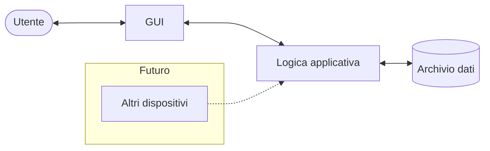
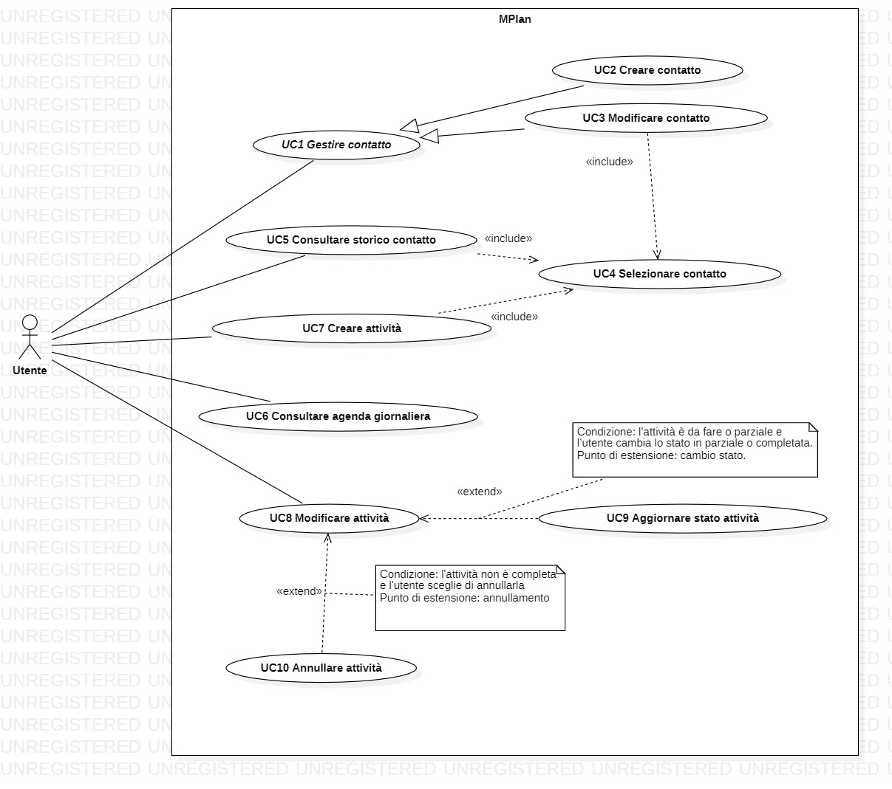
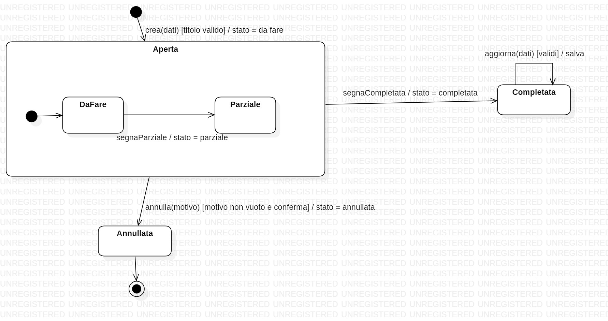

# MPlan – Specifica dei requisiti software

**Documento 3 – Requisiti** (Requirements Engineering e Software Quality)
Corso di Ingegneria del Software, A.A. 2026/27

| Versione | Data | Modifiche |
|---|---|---|
| 0.1.0 | 10/10/2026 | Versione iniziale |
| 0.1.1 | 11/10/2026 | Sistemazione di alcuni errori |
| 0.2.0 | 16/10/2026 | Conferma dei punti da verificare |
| 0.2.1 | 17/10/2026 | Piccole correzioni sintattiche e relative ad ambiguità |
| 0.3.0 | 17/10/2026 | Inserimento dello use case diagram  |
| 0.3.1 | 18/10/2026 | Risolto l'ultimo punto aperto: la fatturazione non è svolta dal sistema |
| 0.3.2 | 24/10/2026 | Qualità del software allineate a ISO/IEC 9126 |
| 0.3.3 | 05/11/2026 | Macchine a stati complete (8.1 e 8.2) |

---

## Indice

1. Introduzione
2. Elicitazione dei requisiti
3. Descrizione generale
4. Casi d'uso
5. Requisiti specifici
   - 5.1 Requisiti funzionali (FUN)
   - 5.2 Requisiti sui dati (DAT)
   - 5.3 Requisiti della GUI (GUI)
   - 5.4 Requisiti non funzionali (NFR)
   - 5.5 Vincoli (VIN)
6. Priorità dei requisiti (MoSCoW)
7. Requisiti futuri e fuori scope
8. Modelli di comportamento
9. Tracciabilità
10. Qualità del software
11. Punti aperti
12. Validazione e accettazione

---

## 1. Introduzione

### 1.1 Scopo del documento

Questo documento specifica i requisiti del software **MPlan**, in forma ispirata allo standard IEEE 830 (distinzione tra requisiti funzionali, di interfaccia, non funzionali e vincoli di progetto) e con il formato dei requisiti del documento di riferimento fornito dal docente (*Mechanical Lung Ventilator – Software Requirements Specification*). Si rivolge al team di sviluppo, al docente e al committente.

### 1.2 Ambito del prodotto

MPlan è un'applicazione per tenere traccia dei **clienti e dei cantieri** di un'azienda che esegue interventi presso terzi, e di tutte le **attività** svolte o da svolgere per ciascuno di essi. Permette di registrare cosa c'è da fare, cosa è stato fatto e quali materiali servono per le visite successive, di consultare lo storico di ogni contatto e di vedere le attività di ogni giorno in un'agenda giornaliera.

**Rientra nella prima versione (v1):**
- rubrica di clienti e cantieri;
- creazione, aggiornamento e annullamento delle attività, con note sui materiali in testo libero;
- storico per contatto e agenda giornaliera;
- salvataggio persistente dei dati sul PC;
- funzionamento su PC (Windows), senza account distinti.

**Non rientra nella v1** (vedi sezione 7): gestione di magazzino, giacenze, soglie minime e costi dei materiali; compilazione ed emissione delle fatture; ruoli e utente master; versione per cellulare; accesso da più dispositivi; autenticazione.

### 1.3 Definizioni e abbreviazioni

| Termine | Definizione |
|---|---|
| Committente | L'azienda che ha commissionato il software e che è stata intervistata (MP elettrica s.a.s.) |
| Cliente | Persona o azienda per cui il committente svolge interventi |
| Utente | Persona del team di lavoro del committente che usa l'applicazione |
| Contatto | Voce della rubrica: un cliente (privato o azienda) oppure un cantiere. Clienti e cantieri sono salvati nella stessa lista |
| Cantiere | Luogo o lavoro, anche prolungato nel tempo, trattato come un contatto. Comprende i condomini e i lavori generali non riferiti a un singolo cliente. |
| Rubrica | L'elenco di tutti i contatti, mostrato nella Home |
| Attività (o intervento) | Lavoro svolto o da svolgere presso un contatto in una data, con titolo, descrizione e note |
| Titolo | Descrizione breve (poche parole) di cosa c'è da fare |
| Descrizione | Testo, compilato dopo l'intervento, su ciò che è stato fatto |
| Note | Testo libero su ciò che manca o serve per la visita successiva, inclusi i materiali |
| Orario | Ora indicativa di inizio di un'attività, usata per ordinare le attività nella giornata. Non c'è un orario di fine |
| Stato | Condizione di un'attività: da fare, parziale, completata, annullata |
| Annullamento | Marcatura di un'attività come annullata, con un motivo, senza eliminarla dallo storico |
| Storico | Elenco di tutte le attività di un contatto |
| Scheda contatto | Schermata con i dati principali di un contatto e, sotto, il suo storico |
| Agenda giornaliera | Schermata che mostra le attività di tutti i contatti relative a un singolo giorno, in un elenco a scorrimento verticale ordinato per orario, con frecce per passare al giorno precedente o successivo (detta anche calendario generale) |
| Home | Schermata iniziale: contiene la rubrica e il menu per aprire l'agenda giornaliera |
| Registro delle modifiche | Elenco delle modifiche e degli annullamenti delle attività, con data, tipo e motivo |
| CF / P.IVA | Codice fiscale / Partita IVA |
| GUI | Interfaccia grafica dell'applicazione |
| v1 | Prima versione, oggetto di questa specifica |
| MoSCoW | Tecnica di priorità: Must, Should, Could, Won't |

Nel documento "committente" indica sempre l'azienda che commissiona il software, mentre "cliente" indica sempre chi riceve gli interventi.

### 1.4 Riferimenti

- *Requisiti per il progetto di ingegneria del software, A.A. 2026/27*, v1.0.0 (A. Gargantini, S. Bonfanti).
- S. Bonfanti, A. Gargantini, *Mechanical Lung Ventilator – Software Requirements Specification for ABZ 2024 case study*, v1.5, dicembre 2023 (documento di riferimento per il formato).
- IEEE Std 830-1998, *Recommended Practice for Software Requirements Specifications*, IEEE, 1998: <https://ieeexplore.ieee.org/document/720574>. Il testo completo è a pagamento; lo standard è stato sostituito da ISO/IEC/IEEE 29148:2011.
- ISO/IEC 9126-1:2001, *Software engineering – Product quality – Part 1: Quality model*, e ISO/IEC TR 9126-4:2004, *Part 4: Quality in use metrics*. Sono stati sostituiti da ISO/IEC 25010, ma sono il modello di qualità usato nel corso e nel Project Plan (9.1).
- Intervista di elicitazione del 08/10/2026: `intervista-01-domande-risposte.md`, `intervista-01-riassunto-esigenze-cliente.md`.

### 1.5 Struttura del documento

- La **sezione 2** descrive come sono stati raccolti i requisiti e quali obiettivi ha il committente.
- La **sezione 3** presenta il prodotto, il contesto attuale, gli utenti, i vincoli e le assunzioni.
- La **sezione 4** elenca i casi d'uso con i relativi scenari.
- La **sezione 5** contiene i requisiti specifici, divisi per tipo in tabelle.
- Le sezioni **6 e 7** riportano le priorità e ciò che è rimandato o escluso.
- La **sezione 8** presenta i modelli di comportamento, la **9** la tracciabilità, la **10** la qualità, la **11** i punti aperti (tutti risolti) e la **12** la validazione.

Il formato dei requisiti (identificatori, rationale e riferimento di origine, tabelle per tipo) segue il documento di riferimento del docente, mentre l'ordine delle sezioni è adattato al progetto. Le sezioni 2 (elicitazione) e 4 (casi d'uso) sono aggiunte rispetto allo standard IEEE 830, di cui il documento mantiene i contenuti:

| Parte di IEEE 830 | Dove in questo documento |
|---|---|
| Introduzione (scopo, ambito, definizioni, riferimenti, panoramica) | 1.1–1.5 |
| Descrizione generale (prospettiva, funzioni, utenti, vincoli, assunzioni, ripartizione dei requisiti) | 3.1–3.6 |
| Requisiti specifici – interfacce esterne | 5.3 (GUI); nessuna interfaccia hardware, software o di comunicazione verso altri sistemi nella v1 (NFR.6) |
| Requisiti specifici – funzioni | 5.1 (FUN) e sezione 4 |
| Requisiti specifici – prestazioni (efficienza) | 5.4 (NFR.3) |
| Requisiti specifici – dati | 5.2 (DAT) |
| Requisiti specifici – vincoli di progetto | 5.5 (VIN) |
| Requisiti specifici – attributi del sistema (affidabilità, sicurezza, manutenibilità, portabilità) | 5.4 (NFR) e sezione 10 |
| Organizzazione dei requisiti e priorità | sezione 5 (per tipo) e sezione 6 (MoSCoW) |
| Tracciabilità e punti aperti | sezioni 9 e 11 |

Come richiesto dallo standard, i requisiti sono identificati in modo univoco, classificati per importanza (sezione 6) e per stabilità (simboli † e ‡), tracciabili (sezione 9) e, dove possibile, verificabili (sezioni 10 e 12).

### 1.6 Convenzioni

**Numerazione dei requisiti.** Come nel documento di riferimento, l'ID ha la forma `XXX.n.y`:

- `XXX` è un codice di tre lettere che indica il tipo di requisito;
- `n` è il numero del requisito;
- `y` è il numero del sotto-requisito: 0 per un requisito padre (di solito omesso) e da 1 a 9 per un figlio (ad esempio `FUN.4` è il padre e `FUN.4.1` un suo figlio).

| Codice | Tipo di requisito |
|---|---|
| FUN | Funzionali |
| DAT | Dati: attributi, formati e valori ammessi |
| GUI | Interfaccia grafica |
| NFR | Non funzionali (usabilità, affidabilità, efficienza, manutenibilità, portabilità, sicurezza) |
| VIN | Vincoli di progetto e di processo |
| FUT | Requisiti futuri, non nella v1 |

I codici sono una convenzione di questo progetto. FUN e GUI derivano da quelli del documento di riferimento; DAT corrisponde ai suoi requisiti su valori e intervalli (PER); NFR, VIN e FUT sono propri di questo progetto. Non servono i codici per allarmi, controller e sicurezza (AL, CONT, SAV) né per le interfacce tra componenti (INT), che sono scelte di design.

**Colonne delle tabelle.** Ogni riga ha: ID, requisito con eventuale *rationale*, priorità MoSCoW (**M**ust, **S**hould, **C**ould, **W**on't) e fonte. La tabella dei dati (5.2) ha in più la colonna *Valori ammessi / predefinito*. Il rationale è indicato solo dove la motivazione non è ovvia, come nel documento di riferimento.

**Fonte.**

| Fonte | Significato |
|---|---|
| `Dx.y` | Domanda dell'intervista (`intervista-01-domande-risposte.md`) |
| `Ox` | Obiettivo del committente (sezione 2.5) |
| `Reg.` | Regolamento del progetto del docente |
| `Team` | Decisione del team di sviluppo |
| `Impl.` | Requisito implicito, necessario per rendere coerenti quelli emersi |
| `FUN.x`, … | Requisito che la riga realizza (nelle tabelle GUI, dopo il punto e virgola) |

**Affidabilità della fonte.**

- † = la risposta dell'intervista è segnata *PARZIALE* (da confermare).
- ‡ = proposta o scelta del team non ancora confermata dal committente: può essere una risposta segnata *PROPOSTA* (esempio: `D8.3‡`) oppure una scelta senza domanda d'origine (esempio: `Team‡`, `Impl.‡`).
- Nessun simbolo = risposta chiara del committente, vincolo del regolamento o decisione del team che non richiede conferma.

I simboli indicano anche i requisiti meno stabili, cioè quelli che hanno più probabilità di cambiare.

### 1.7 Gestione dei requisiti

Ogni requisito attraversa quattro stati: *proposto*, *validato* (confermato dal committente, sezione 12), *implementato* e *verificato* (test superato, sezione 9.4). Lo stato non è scritto in questo documento ma è tracciato nelle issue di GitHub, ad esempio con un'etichetta per stato.

Regole di modifica:

1. una modifica a un requisito parte da una issue che ne cita l'ID;
2. il messaggio di commit riporta lo stesso ID;
3. dopo la prima validazione con il committente un ID non viene più riutilizzato né rinumerato: un requisito eliminato resta nel documento come *eliminato*;
4. ogni modifica del documento è annotata nella tabella delle versioni.

---

## 2. Elicitazione dei requisiti

### 2.1 Tecnica usata

I requisiti sono stati raccolti con un'**intervista strutturata** al committente, condotta il 08/10/2026 da due membri del team, della durata di circa 45 minuti. Le informazioni emerse sono state riordinate, insieme alle domande poste, nei due documenti elencati in 2.2.

### 2.2 Documenti prodotti

| File | Contenuto |
|---|---|
| `intervista-01-domande-risposte.md` | Domande e risposte, con stato di ogni risposta |
| `intervista-01-riassunto-esigenze-cliente.md` | Riassunto di ciò che vuole il committente, decisioni del team e punti confermati o opzionali |

### 2.3 Limiti e come sono stati gestiti

- Per alcune parti dell'intervista le informazioni disponibili sono incomplete; sono state integrate con gli appunti del team.
- Ogni risposta ha uno stato: **EMERSO**, **PARZIALE**, **PROPOSTA** o **NON EMERSO**. Nei requisiti i simboli † e ‡ ne segnalano le conseguenze (vedi 1.6).
- Durante l'intervista alcune richieste sono **cambiate**: il calendario è stato chiesto, poi giudicato non indispensabile, poi di nuovo richiesto. Nella specifica vale l'ultima versione, con le scelte del team descritte in 2.4.
- Alcuni temi **non sono emersi** (costi, magazzino, giacenze, soglie): non diventano requisiti. Sono elencati nella sezione 7.

### 2.4 Scelte del team dopo l'intervista

Dopo l'intervista il team ha deciso che:

- la **v1** è un'applicazione per PC **senza account distinti**, con **archivio dati locale** (A1);
- l'**utente master** e la gestione dei ruoli sono **fuori scope**;
- il **cellulare** e l'accesso da più dispositivi sono evoluzioni future, con una possibile password unica generale non condivisa con estranei;
- la **schermata iniziale** è la rubrica dei contatti (D5.3);
- le **attività annullate** restano visibili e contrassegnate come annullate;
- al posto di un calendario con viste a mese e a settimana, l'**agenda giornaliera** mostra **un giorno alla volta**, con frecce per cambiare giorno e un elenco a scorrimento verticale ordinato per orario (FUN.10); lo **storico** di un contatto è un elenco ordinato per data (FUN.9). Sono modifiche rispetto a D5.1 e D6.1;
- ogni attività ha **un solo orario indicativo**, senza orario di fine; non si usano mezza giornata e giornata intera (DAT.2.3). È una modifica rispetto a D3.2.

### 2.5 Obiettivi del committente

Nell'intervista (D1.2) il committente ha indicato quattro obiettivi di alto livello. Ognuno è raffinato in requisiti, e ogni requisito che lo realizza lo cita nella colonna *Fonte*.

| ID | Obiettivo | Requisiti che lo realizzano |
|---|---|---|
| O1 | Sapere cosa è stato fatto e cosa resta da fare per ogni cliente | FUN.5.1, FUN.6, FUN.8, FUN.9 |
| O2 | Riassumere il lavoro della giornata | FUN.5.1, FUN.10 |
| O3 | Preparare i materiali per il giorno dopo | FUN.8, FUN.8.1 |
| O4 | Ritrovare a fine mese gli interventi, per la fatturazione | FUN.9, FUN.9.1 |

La fattura mensile non è prodotta dal sistema: l'utente la compila a mano, a partire dallo storico del contatto (sezione 7.2).

---

## 3. Descrizione generale

### 3.1 Prospettiva del prodotto

MPlan è un'applicazione autonoma per PC. Non dipende da servizi esterni e conserva i dati sul computer su cui è installata. È composta da un'interfaccia grafica, dalla logica dell'applicazione e da un archivio dati locale.



*Figura 3.1 – Architettura ad alto livello. La parte tratteggiata è un'evoluzione futura.*

**Contesto attuale.** Il flusso di lavoro che MPlan sostituisce è stato ricostruito solo in parte:

| Fase | Cosa risulta oggi | Fonte |
|---|---|---|
| Prima degli interventi | Il committente usa un calendario in cui segna gli appuntamenti già fissati con i clienti | D1.1 |
| Durante l'intervento | Non emerso | – |
| Fine giornata | Non emerso come oggi riassuma il lavoro e prepari i materiali; sono obiettivi (O2, O3) | D1.2 |
| Fine mese | Non emerso come oggi ricavi l'elenco degli interventi; è un obiettivo (O4) | D1.2 |
| Strumenti usati (carta, moduli, altri programmi) | Non emerso | – |


### 3.2 Funzioni del prodotto

1. Gestire la rubrica di clienti e cantieri.
2. Registrare le attività svolte o da svolgere per ogni contatto, con titolo, data, orario indicativo, descrizione e note.
3. Aggiornare lo stato di un'attività (da fare, parziale, completata) e annullarla indicando un motivo.
4. Annotare i materiali usati, mancanti o necessari come testo libero.
5. Consultare lo storico di un contatto.
6. Consultare l'agenda giornaliera, con le attività di tutti i contatti.
7. Conservare i dati in modo persistente per anni.

### 3.3 Utenti

Gli utenti sono le persone del team di lavoro del committente. Nella v1 usano lo stesso PC a turno, senza account distinti (A1). Il committente privilegia la semplicità e il raggiungimento, tramite pochi passaggi, delle varie funzioni dell'applicazione(D9.4): per questo la semplicità d'uso è un requisito prioritario (NFR.1).

### 3.4 Vincoli generali

Il progetto deve rispettare il regolamento del corso: Java, progetti Eclipse con Maven, database embedded, nessun servizio esterno, test JUnit, UML con StarUML, repository GitHub. I vincoli sono in 5.5.

### 3.5 Assunzioni e dipendenze

| ID | Assunzione |
|---|---|
| A1 | L'applicazione è installata su un solo PC, che il team di lavoro del committente usa a turno per registrare il proprio lavoro; non ci sono account distinti né accessi contemporanei e i dati stanno solo su quel PC (D8.1, D8.2; assunzione del team) |
| A2 | Il PC ha Windows 11 e una versione di Java 21 |
| A3 | Il committente scrive i dati a mano: non esiste un archivio da importare (D2.2) |
| A4 | Il lavoro su un cantiere lungo si registra con un'attività per ogni giorno lavorato (D3.6) |
| A5 | Le note di ciò che serve per la visita successiva si scrivono nell'attività del giorno stesso (D4.2) |

### 3.6 Ripartizione per versione

| Versione | Contenuto |
|---|---|
| **v1** | Requisiti con priorità M e S di questa specifica (quelli C solo se resta tempo): per PC, senza account distinti, archivio dati locale |
| **Evoluzioni** | Sezione 7: cellulare, più dispositivi, password unica |
| **Fuori scope** | Sezione 7: utente master, magazzino, giacenze, costi |

---

## 4. Casi d'uso


*Figura 4.1: Diagramma dei Casi d'Uso di MPlan.*

| ID | Caso d'uso | Descrizione | Requisiti collegati |
|---|---|---|---|
| **UC1** | Gestire contatto | *(Caso d'uso astratto)* Gestione dell'anagrafica di un cliente o cantiere nella rubrica. Specializzato da UC2 e UC3. | FUN.1, FUN.2, DAT.1, GUI.3 |
| **UC2** | Creare contatto | L'utente inserisce a mano un nuovo cliente o cantiere specificandone i dati anagrafici principali. | FUN.1, FUN.1.1, FUN.1.2, FUN.1.3, FUN.1.4, DAT.1, DAT.5, GUI.2.1, GUI.3, GUI.3.1 |
| **UC3** | Modificare contatto | L'utente corregge o aggiorna le informazioni anagrafiche di un contatto selezionato dalla rubrica. | FUN.2, DAT.1, DAT.5, GUI.3, GUI.3.1 |
| **UC4** | Selezionare contatto | L'utente individua e seleziona un contatto dalla rubrica (Home) per visualizzarne la scheda, modificarne i dati o associargli una nuova attività. | FUN.3, FUN.3.1, GUI.2, GUI.2.3 |
| **UC5** | Consultare storico contatto | Dalla scheda di un contatto selezionato, l'utente consulta l'elenco cronologico delle attività svolte e programmate. | FUN.9, FUN.9.1, GUI.4, GUI.4.2 |
| **UC6** | Consultare agenda giornaliera | Dalla Home, l'utente apre l'agenda per visualizzare le attività di tutti i contatti pianificate in un determinato giorno, navigando con le frecce tra le date. | FUN.10, FUN.10.1, FUN.10.2, FUN.10.3, FUN.10.4, GUI.2.2, GUI.7, GUI.7.1, GUI.7.2 |
| **UC7** | Creare attività | L'utente inserisce un nuovo intervento associato a un contatto selezionato, specificando titolo, data, orario indicativo ed eventuali note/materiali. | FUN.4, FUN.4.1, FUN.4.2, FUN.4.3, FUN.7, FUN.8, FUN.8.1, DAT.2, DAT.3, DAT.5, GUI.4.1, GUI.5, GUI.5.1 |
| **UC8** | Modificare attività | L'utente apre un'attività esistente e ne aggiorna i contenuti testuali (descrizione dell'intervento svolto, note e materiali necessari). | FUN.5, FUN.5.1, FUN.8, FUN.8.1, FUN.13, DAT.2, DAT.4, DAT.5, GUI.4.2, GUI.5, GUI.7.2 |
| **UC9** | Aggiornare stato attività | *Estensione di UC8:* quando un'attività è in stato *da fare* o *parziale*, l'utente ne fa avanzare lo stato contrassegnandola come *parziale* o *completata*. | FUN.6, FUN.6.1, FUN.6.3, DAT.3, GUI.5.2 |
| **UC10** | Annullare attività | *Estensione di UC8:* quando un'attività non è conclusa, l'utente la marca in modo permanente come *annullata*, inserendo obbligatoriamente il motivo. | FUN.6.2, FUN.6.3, FUN.12, FUN.12.1, FUN.12.2, FUN.13, DAT.3, DAT.3.1, DAT.4, GUI.6, GUI.8 |

> **Nota:** I requisiti `FUN.11` (salto diretto a una data) e `FUN.14` (notifica serale di promemoria) hanno priorità *Could* e non costituiscono casi d'uso a sé stanti: FUN.11 è un raffinamento opzionale di UC6, mentre FUN.14 è un servizio in background. I requisiti `FUN.15`, `NFR.*`, `VIN.*`, `GUI.1` e `GUI.1.1` sono requisiti architetturali e non funzionali trasversali a tutti i casi d'uso.

---

### 4.1 Scenari principali

Gli scenari descrivono il flusso nominale di interazione per ciascun caso d'uso e costituiscono la base per i criteri di accettazione (sezione 12).

| ID | Scenario principale | Risultato atteso |
|---|---|---|
| **UC1** | *(Caso d'uso astratto)* Non invocabile direttamente: si concretizza nell'esecuzione di UC2 o UC3. | – |
| **UC2** | 1. Dalla Home l'utente seleziona "Nuovo contatto".<br>2. Compila i dati anagrafici inserendo almeno la denominazione/nome obbligatorio (DAT.1.1).<br>3. Conferma il salvataggio.<br>*Flusso alternativo:* se uno o più campi obbligatori mancano o hanno formato errato (DAT.5), il sistema segnala l'errore e mantiene i dati inseriti senza salvare. | Il nuovo contatto viene memorizzato con persistenza e compare nell'elenco della rubrica. |
| **UC3** | 1. L'utente individua il contatto tramite la rubrica (include UC4).<br>2. Dalla scheda contatto seleziona "Modifica".<br>3. Aggiorna i campi anagrafici desiderati e conferma il salvataggio. | La scheda e la rubrica mostrano i dati del contatto aggiornati. |
| **UC4** | 1. Dalla schermata Home l'utente visualizza l'elenco della rubrica.<br>2. Scorre l'elenco (o ne filtra i nominativi) e clicca sulla riga del contatto desiderato. | Il contatto viene selezionato, rendendo disponibili le sue informazioni per l'apertura della scheda (UC5), la modifica anagrafica (UC3) o la creazione di attività (UC7). |
| **UC5** | 1. L'utente seleziona un contatto dalla rubrica (include UC4).<br>2. Si apre la scheda contatto: in alto compaiono i dati anagrafici, in basso lo storico degli interventi.<br>3. (Opzionale) L'utente applica il filtro per visualizzare solo la settimana o il mese selezionato (FUN.9.1). | Vengono visualizzate tutte e sole le attività del contatto nel periodo richiesto, ordinate dalla più recente alla più remota. |
| **UC6** | 1. Dalla Home l'utente seleziona l'opzione "Agenda giornaliera" dal menu a tendina.<br>2. L'applicazione mostra la data odierna con le attività di tutti i contatti ordinate per orario di inizio (e quelle senza orario in cima).<br>3. L'utente preme i pulsanti freccia per scorrere al giorno precedente o successivo. | L'agenda si aggiorna mostrando la lista delle attività pianificate per la data visualizzata. |
| **UC7** | 1. L'utente seleziona il contatto per cui creare l'attività (include UC4).<br>2. Dalla scheda contatto seleziona "Nuova attività".<br>3. Inserisce il titolo obbligatorio dell'intervento; data odierna preimpostata, orario e note facoltativi.<br>4. Conferma il salvataggio. | L'attività nasce con stato *da fare* e viene registrata sia nello storico del contatto sia nell'agenda del giorno corrispondente. |
| **UC8** | 1. L'utente apre un'attività esistente tramite lo storico (UC5) o tramite l'agenda (UC6).<br>2. Compila o aggiorna il testo della descrizione dei lavori svolti e/o le note sui materiali mancanti.<br>3. Conferma il salvataggio. | Le informazioni descrittive dell'attività vengono memorizzate e rimangono consultabili. |
| **UC9** | *(Punto di estensione: cambio stato in UC8)*<br>1. In fase di modifica di un'attività con stato *da fare* o *parziale*, l'utente seleziona il nuovo stato operativo (*parziale* o *completata*).<br>2. Salva l'attività. | Lo stato dell'attività viene aggiornato e recepito sia nello storico che nell'agenda del giorno. |
| **UC10** | *(Punto di estensione: annullamento in UC8)*<br>1. In fase di apertura/modifica di un'attività non completata, l'utente seleziona "Annulla attività".<br>2. Il sistema richiede la motivazione obbligatoria dell'annullamento e una conferma esplicita (GUI.6).<br>3. L'utente inserisce la motivazione e conferma. | L'attività viene contrassegnata in modo definitivo come *annullata* con la relativa motivazione; non viene eliminata ma resta visibile con marcatura grafica dedicata (GUI.8). |

---

## 5. Requisiti specifici

Legenda: priorità **M**/**S**/**C**/**W** = Must/Should/Could/Won't; † fonte parziale, ‡ proposta o scelta del team non confermata (vedi 1.6).

### 5.1 Requisiti funzionali (FUN)

Coprono la rubrica, le attività, i materiali, lo storico, l'agenda giornaliera, l'annullamento e la persistenza.

| ID | Requisito / Rationale | Pri. | Fonte |
|---|---|---|---|
| **FUN.1** | Il sistema deve permettere di creare un contatto (cliente o cantiere) inserendone i dati a mano.<br>*Rationale:* il committente non ha un archivio da importare. | M | D2.2 |
| FUN.1.1 | Per ogni contatto il sistema deve poter memorizzare gli attributi definiti in DAT.1. | M | D2.1 |
| FUN.1.2 | Codice fiscale e partita IVA devono essere facoltativi.<br>*Rationale:* il committente li vuole "se possibile"; servono per la fatturazione. | M | D2.1 |
| FUN.1.3 | Un cantiere deve essere trattato come un contatto e salvato nella stessa rubrica dei clienti.<br>*Rationale:* i lavori in uno stesso luogo si registrano con il nome del luogo, senza una struttura separata. | M | D2.4, D2.5, D5.3 |
| FUN.1.4 | Il sistema potrebbe permettere di indicare con un flag se il contatto è un privato o un'azienda.<br>*Rationale:* distinzione utile ma non fondamentale. | C | D2.3 |
| **FUN.2** | Il sistema deve permettere di modificare i dati di un contatto esistente.<br>*Rationale:* necessario per correggere i dati (UC3, GUI.3); non discusso esplicitamente. | M | Impl. |
| **FUN.3** | Il sistema deve mostrare la rubrica: l'elenco di tutti i contatti salvati (clienti e cantieri). | M | D5.3 |
| FUN.3.1 | Il sistema potrebbe permettere di cercare un contatto per nome.<br>*Rationale:* la rubrica cresce negli anni; non discusso. | C | Impl. |
| **FUN.4** | Il sistema deve permettere di creare un'attività associata a un contatto. | M | D3.1, D5.1 |
| FUN.4.1 | Un'attività deve poter contenere gli attributi definiti in DAT.2. | M | D3.1 |
| FUN.4.2 | Per creare un'attività deve bastare inserire il titolo: la data ha un valore predefinito (DAT.2.2), l'orario è facoltativo (DAT.2.3), il contatto è quello della scheda aperta, e descrizione e note si compilano dopo.<br>*Rationale:* il titolo dice cosa c'è da fare, il resto si scrive a lavoro svolto. | M | D3.3 |
| FUN.4.3 | L'orario di un'attività deve essere indicativo: orario hh:mm facoltativo.<br>*Rationale:* il committente non chiede precisione oraria; le attività sono mostrate in ordine di orario d'inizio. | M | D3.2, Team |
| **FUN.5** | Il sistema deve permettere di modificare i dati di un'attività esistente (vedi FUN.6.2 per le attività annullate). | M | D3.4 |
| FUN.5.1 | Dopo l'intervento l'utente deve poter compilare e aggiornare descrizione e note, anche più volte. | M | D3.3, D3.4, O1, O2 |
| **FUN.6** | Ogni attività deve avere uno stato tra: *da fare*, *parziale*, *completata*, *annullata*.<br>*Rationale:* il committente ha citato *completata*, *parziale* e *annullata* e lo considera opzionale; lo stato iniziale *da fare* è stato aggiunto dal team perché ogni attività nasce prima dell'intervento. | M | D3.5, Impl., O1 |
| FUN.6.1 | L'utente deve poter segnare un'attività come *parziale* o *completata*. | M | D3.5 |
| FUN.6.2 | Lo stato *annullata* deve essere definitivo: un'attività annullata non può essere modificata né tornare ad altri stati.<br>*Rationale:* semplifica lo storico; da confermare. | M | Impl. |
| FUN.6.3 | Il sistema deve ammettere solo queste transizioni di stato: da *da fare* a *parziale*; da *da fare* o *parziale* a *completata*; da *da fare* o *parziale* ad *annullata*. Un'attività *completata* non può essere annullata.<br>*Rationale:* la Figura 8.1 illustra queste transizioni. | M | Impl. |
| **FUN.7** | Un lavoro che dura più giorni deve essere rappresentato da più attività, una per ogni giorno lavorato, associate allo stesso contatto.<br>*Rationale:* il committente non ha chiesto una funzione di pianificazione di cantiere. | M | D3.6 |
| **FUN.8** | Il sistema deve permettere di annotare materiali usati, mancanti o necessari come testo libero nelle note dell'attività. | M | D4.1, O1, O3 |
| FUN.8.1 | La nota su ciò che serve per la visita successiva deve essere scritta nell'attività del giorno stesso, non in quella del giorno dopo. | M | D4.2, O3 |
| **FUN.9** | Il sistema deve mostrare lo storico di un contatto: l'elenco di tutte le sue attività, a scorrimento verticale, ordinate per data e orario dalla più recente.<br>*Rationale:* il committente vuole vedere cosa è stato fatto per ogni cliente e, a fine mese, ritrovare gli interventi per la fatturazione. La fattura è compilata a mano dall'utente, fuori dal sistema (7.2). Il formato a elenco, al posto di un calendario, è una scelta del team. | M | D5.1, D5.2, O1, O4, Team |
| FUN.9.1 | Il sistema deve permettere di limitare lo storico di un contatto a una settimana (lunedì-domenica) o a un mese di calendario scelti dall’utente, anche passati; predefiniti: settimana o mese correnti. | M | D5.2, O4, Team |
| **FUN.10** | Il sistema deve fornire un'agenda giornaliera che mostra le attività di tutti i contatti relative a un singolo giorno.<br>*Rationale:* il committente vuole vedere le attività svolte di tutti i clienti; la scelta di mostrare un giorno alla volta è del team. | M | D6.2, O2, Team |
| FUN.10.1 | L'utente deve poter passare al giorno precedente o successivo con apposite frecce. | M | D6.1, Team |
| FUN.10.2 | Le attività del giorno devono essere mostrate in un elenco a scorrimento verticale, in ordine di orario. | M | D6.1, Team |
| FUN.10.3 | Le attività senza orario devono essere mostrate all'inizio del giorno, prima di quelle con orario.<br>*Rationale:* l'orario è facoltativo (DAT.2.3), quindi saranno in ordine casuale. | M | Impl. |
| FUN.10.4 | All'apertura l'agenda dovrebbe mostrare il giorno corrente. | S | Impl. |
| **FUN.11** | Il sistema potrebbe permettere di andare direttamente a un giorno scelto nell'agenda.<br>*Rationale:* le sole frecce sarebbero lente per raggiungere giorni lontani. | C | Impl. |
| **FUN.12** | Il sistema deve permettere di annullare un'attività *da fare* o *parziale* indicando un motivo. | M | D7.1 |
| FUN.12.1 | Un'attività annullata deve restare nello storico e nell'agenda, contrassegnata come annullata e con il motivo registrato. | M | D7.1 |
| FUN.12.2 | Il sistema non deve permettere di eliminare definitivamente un'attività.<br>*Rationale:* lo storico deve restare completo per ritrovare gli interventi da fatturare e per la consultazione negli anni. | M | D7.1 |
| **FUN.13** | Il sistema dovrebbe registrare le modifiche e gli annullamenti delle attività, con data, tipo di modifica e motivo.<br>*Rationale:* nella v1, senza account distinti, l'autore non si può registrare (vedi FUT.4). | S | D7.2 |
| **FUN.14** | Il sistema potrebbe mostrare una notifica a fine giornata per ricordare di compilare le note.<br>*Rationale:* il committente la considera opzionale. | C | D9.3 |
| **FUN.15** | Il sistema deve salvare i dati in modo persistente e ritrovarli alla riapertura dell'applicazione. | M | D9.2 |
| FUN.15.1 | Lo storico deve restare consultabile per anni: nessun dato deve essere cancellato automaticamente. | M | D9.2 |

### 5.2 Requisiti sui dati (DAT)

Definiscono attributi, formati e valori ammessi, come i requisiti *PER* (valori e intervalli) del documento di riferimento. Dove un campo è indicato come obbligatorio o facoltativo, e per le lunghezze massime e i valori predefiniti, la scelta è un'assunzione del team (`Impl.`) da confermare in fase di design.

| ID | Requisito / Rationale | Valori ammessi / predefinito | Pri. | Fonte |
|---|---|---|---|---|
| **DAT.1** | **Contatto.** Il sistema deve poter memorizzare per ogni contatto gli attributi seguenti. | – | M | D2.1 |
| DAT.1.1 | *Nome* (o denominazione, per aziende e cantieri). | Testo, obbligatorio, massimo 100 caratteri | M | Impl. |
| DAT.1.2 | *Cognome*. | Testo, facoltativo, massimo 100 caratteri | M | D2.1, Impl. |
| DAT.1.3 | *Indirizzo*. | Testo, facoltativo, massimo 200 caratteri | M | D2.1, Impl. |
| DAT.1.4 | *Telefono*: uno o più numeri. | Facoltativo; ogni numero al massimo 20 caratteri | M | D2.1, Impl. |
| DAT.1.5 | *Codice fiscale*. | Facoltativo; 16 caratteri alfanumerici (persone fisiche) oppure 11 cifre (aziende ed enti) | M | D2.1 |
| DAT.1.6 | *Partita IVA*. | Facoltativa; 11 cifre | M | D2.1 |
| DAT.1.7 | *Tipo*: privato oppure azienda. | Facoltativo; nessun valore predefinito | C | D2.3 |
| **DAT.2** | **Attività.** Il sistema deve poter memorizzare per ogni attività gli attributi seguenti. | – | M | D3.1 |
| DAT.2.1 | *Titolo*. | Testo breve, obbligatorio, massimo 100 caratteri | M | D3.1, D3.3 |
| DAT.2.2 | *Data*. | Data di calendario, obbligatoria; predefinita: data corrente | M | D3.1, Impl. |
| DAT.2.3 | *Orario indicativo* di inizio. Non è previsto un orario di fine. | Ora del giorno (hh:mm), facoltativa; predefinita: vuota | M | D3.2, Team |
| DAT.2.4 | *Descrizione*. | Testo libero, facoltativo alla creazione, massimo 5000 caratteri | M | D3.3, Impl. |
| DAT.2.5 | *Note*: vi si annotano anche i materiali (FUN.8). | Testo libero, facoltativo, massimo 5000 caratteri | M | D3.1, D4.1 |
| DAT.2.6 | *Contatto* a cui appartiene l'attività. | Riferimento obbligatorio a un contatto esistente | M | D5.1 |
| **DAT.3** | **Stato.** Lo stato di un'attività deve assumere uno dei valori *da fare*, *parziale*, *completata*, *annullata*. | Predefinito alla creazione: *da fare* | M | D3.5, Impl. |
| DAT.3.1 | Il *motivo di annullamento* è obbligatorio quando lo stato è *annullata*, altrimenti vuoto. | Testo, massimo 1000 caratteri | M | D7.1 |
| **DAT.4** | **Registro modifiche.** Ogni voce dovrebbe contenere data e ora, attività interessata, tipo di modifica e motivo (se presente). | Motivo facoltativo | S | D7.2 |
| **DAT.5** | **Dati non validi.** Quando un dato inserito non rispetta i vincoli di questa sezione (campo obbligatorio vuoto, lunghezza oltre il massimo, formato non valido di codice fiscale, partita IVA, data o orario), il sistema non deve salvarlo, deve mostrare un messaggio che indica il campo e il motivo e deve conservare gli altri dati inseriti nel modulo perché possano essere corretti. | – | M | Impl. |

### 5.3 Requisiti della GUI (GUI)

Le schermate e le transizioni sono illustrate nelle Figure 8.2, 8.3 e 8.4. Come nel documento di riferimento, la colonna *Fonte* indica anche i requisiti funzionali che la GUI realizza.

| ID | Requisito / Rationale | Pri. | Fonte |
|---|---|---|---|
| **GUI.1** | L'applicazione deve avere le schermate: *Home* (rubrica), *Form contatto*, *Scheda contatto*, *Form attività*, *Agenda giornaliera*. | M | D5.3, D5.1, D6.2; FUN.3, FUN.9, FUN.10 |
| GUI.1.1 | La navigazione deve rispettare queste regole: dalla Home si accede alla Scheda contatto, al Form contatto (nuovo contatto) e all'Agenda giornaliera; dalla Scheda contatto si accede al Form contatto (modifica) e al Form attività; dall'Agenda giornaliera si accede al Form attività; da ogni schermata si torna alla schermata di provenienza e, passando per le schermate intermedie, alla Home.<br>*Rationale:* la Figura 8.2 illustra queste regole. | M | Impl. |
| **GUI.2** | **Home.** La schermata iniziale deve mostrare la rubrica: l'elenco di tutti i contatti e cantieri salvati. | M | D5.3; FUN.3 |
| GUI.2.1 | Dalla Home deve essere possibile creare un nuovo contatto. | M | D2.2; FUN.1 |
| GUI.2.2 | Dalla Home un menu a tendina deve permettere di aprire l'agenda giornaliera. | M | D6.2; FUN.10 |
| GUI.2.3 | La selezione di un contatto nella rubrica deve aprirne la scheda. | M | D5.1; FUN.9 |
| **GUI.3** | **Form contatto.** Un modulo deve permettere di inserire o modificare i dati di un contatto. | M | D2.1, D2.2; FUN.1, FUN.2 |
| GUI.3.1 | I campi facoltativi non devono impedire il salvataggio se vuoti. | M | D2.1; FUN.1.2, DAT.1 |
| **GUI.4** | **Scheda contatto.** In alto devono comparire il nome e i dati principali del contatto e, subito sotto, il suo storico (FUN.9). | M | D5.1, Team; FUN.9 |
| GUI.4.1 | La scheda deve offrire l'opzione di creare una nuova attività con i campi di DAT.2 | M | D5.1; FUN.4 |
| GUI.4.2 | Dallo storico deve essere possibile aprire un'attività per consultarla o modificarla. | M | Impl.; FUN.5 |
| **GUI.5** | **Form attività.** Un modulo deve permettere di inserire o modificare titolo, data, orario, descrizione, note e stato. | M | D3.1, D3.2; FUN.4, FUN.5 |
| GUI.5.1 | Per salvare una nuova attività il form deve applicare le regole di FUN.4.2. | M | D3.3; FUN.4.2 |
| GUI.5.2 | Dal form deve essere possibile segnare l'attività come *parziale* o *completata*. | M | D3.5; FUN.6.1 |
| **GUI.6** | **Annullamento.** L'opzione di annullamento deve chiedere il motivo (DAT.3.1) e una conferma prima di procedere. | M | D7.1; FUN.12 |
| **GUI.7** | **Agenda giornaliera.** La schermata deve realizzare l'agenda giornaliera (FUN.10) e mostrare le frecce per cambiare giorno (FUN.10.1). | M | D6.2; FUN.10 |
| GUI.7.1 | Ogni attività nell'agenda dovrebbe mostrare l'orario, il contatto e il titolo. | S | Impl.; FUN.10 |
| GUI.7.2 | Dall'agenda deve essere possibile aprire un'attività per consultarla o modificarla. | M | Impl.; FUN.5 |
| **GUI.8** | Le attività annullate devono essere distinguibili visivamente dalle altre nell'agenda e nello storico. | M | D7.1; FUN.12.1 |

### 5.4 Requisiti non funzionali (NFR)

| ID | Requisito / Rationale | Pri. | Fonte |
|---|---|---|---|
| **NFR.1** | **Usabilità.** L'applicazione deve essere semplice da usare, con poche informazioni da compilare. La verifica è una prova d'uso con il committente (sezione 10).<br>*Rationale:* il committente chiede poche informazioni da scrivere e nessuna complicazione. | M | D9.4 |
| NFR.1.1 | Il sistema deve permettere di creare un'attività dalla Home in ≤ 6 click. | M | D3.3, D9.4 |
| NFR.1.2 | La totalità del team dovrebbe completare UC6, UC7 e UC8 in ≤ 2 min senza aiuto. | S | D9.4 |
| **NFR.2** | **Affidabilità.** Dopo ogni operazione di salvataggio i dati devono essere scritti in modo persistente, così da non perderli in caso di chiusura inattesa.<br>*Rationale:* il lavoro di una giornata non deve andare perso. | M | Team |
| **NFR.3** | **Efficienza.** L'apertura di una scheda contatto deve richiedere meno di 2 secondi con almeno 5000 attività salvate.<br>*Rationale:* il committente vuole consultare la storia per anni (D9.2). | M | Team |
| **NFR.4** | **Portabilità.** L'applicazione deve funzionare su Windows 11. | M | D9.1 |
| **NFR.5** | **Manutenibilità.** Il sistema deve poter evolvere verso l'uso da cellulare e da più dispositivi senza dover riscrivere le funzioni già realizzate. | M | D9.1, Team |
| **NFR.6** | **Funzionamento offline.** L'applicazione deve funzionare senza connessione a Internet e senza servizi da installare. | M | Reg., D9.2 |
| **NFR.7** | **Sicurezza.** I dati devono essere salvati solo in locale, senza invio in rete (A1).<br>*Rationale:* il committente ha detto che solo il suo team di lavoro deve accedere tramite pc. | M | D8.2 |

### 5.5 Vincoli (VIN)

Non descrivono il comportamento del software ma sono imposti dal regolamento del corso o dal team (vincoli di progetto, secondo IEEE 830).

| ID | Requisito / Rationale | Pri. | Fonte |
|---|---|---|---|
| **VIN.1** | Il sistema deve essere scritto in Java, usando le caratteristiche del linguaggio: package, interfacce, classi astratte, collection, costrutti moderni. | M | Reg. |
| **VIN.2** | Il codice deve essere organizzato in progetti Eclipse con Maven, test in una cartella separata e nessun riferimento a percorsi assoluti. | M | Reg. |
| **VIN.3** | Il database deve essere embedded; non devono essere necessari servizi esterni da installare, salvo accordo con il docente. | M | Reg., Team |
| **VIN.4** | Il progetto deve usare almeno una dipendenza esterna gestita con Maven (ad esempio log4j). | M | Reg. |
| **VIN.5** | Il sistema deve avere casi di test JUnit di unità, con descrizione nella documentazione. | M | Reg. |
| **VIN.6** | Lo sviluppo deve usare GitHub con commit di tutti i membri, branch, issue, pull request e code review; il `.gitignore` deve escludere i file generati ma non il `.project`. | M | Reg. |
| **VIN.7** | La modellazione deve usare StarUML e il progetto StarUML deve essere caricato nel repository. | M | Reg. |
| **VIN.8** | Nel repository il codice deve essere separato dai documenti (`code/` e `docs/`). | M | Reg., Team |

---

## 6. Priorità dei requisiti (MoSCoW)

### 6.1 Scelta della tecnica

Per classificare i requisiti si usa **MoSCoW** (Must, Should, Could, Won't). Il **modello di Kano** non è stato scelto perché richiede, per ogni funzione, un questionario al committente sulla soddisfazione in presenza e in assenza della funzione, mentre si dispone di una sola intervista. MoSCoW permette invece di decidere in modo semplice cosa deve entrare nella v1.

### 6.2 Criteri

| Priorità | Criterio |
|---|---|
| **M** – Must | Indispensabile per la v1: emerso dal committente, richiesto dal regolamento, deciso dal team o necessario per rendere coerenti gli altri requisiti |
| **S** – Should | Importante ma non indispensabile: miglioramento implicito oppure proposta del team da confermare |
| **C** – Could | Utile ma non fondamentale, oppure idea la cui utilità per il committente è ancora incerta |
| **W** – Won't | Non nella v1: rimandato (sezione 7.1) o escluso (sezione 7.2) |

La priorità e l'affidabilità della fonte sono indipendenti. Un requisito Must può avere un dettaglio ancora da confermare: in quel caso la fonte porta † o ‡ (vedi 1.6). Nel testo dei requisiti il verbo segue la priorità: *deve* per i Must, *dovrebbe* per i Should, *potrebbe* per i Could.

### 6.3 Riepilogo

| Tipo | Must | Should | Could | Won't | Totale |
|---|---|---|---|---|---|
| FUN – Funzionali | 30 | 2 | 4 | – | 36 |
| DAT – Dati | 17 | 1 | 1 | – | 19 |
| GUI – Interfaccia | 18 | 1 | – | – | 19 |
| NFR – Non funzionali | 8 | 1 | – | – | 9 |
| VIN – Vincoli | 8 | – | – | – | 8 |
| FUT – Futuri | – | – | – | 4 | 4 |
| **Totale** | **81** | **5** | **5** | **4** | **95** |

---

## 7. Requisiti futuri e fuori scope

### 7.1 Evoluzioni previste (Won't nella v1)

| ID | Requisito | Pri. | Fonte |
|---|---|---|---|
| FUT.1 | Il sistema potrà essere usato da cellulare. | W | D9.1 |
| FUT.2 | Il sistema potrà essere usato da più dispositivi sugli stessi dati, ad esempio da ogni persona del team con il proprio dispositivo. | W | D9.1 |
| FUT.3 | L'accesso da più dispositivi potrà essere protetto da una password unica generale, da non condividere con estranei al sistema. | W | D8.3 |
| FUT.4 | Quando le persone del team avranno account distinti, il registro delle modifiche indicherà anche chi ha effettuato ciascuna modifica. | W | D7.2 |

Le evoluzioni saranno specificate in dettaglio quando verranno pianificate.

### 7.2 Esclusioni

| Funzione esclusa | Motivo |
|---|---|
| Utente master, ruoli e permessi | Decisione del team: la v1 è senza account distinti (D8.1) |
| Gestione del magazzino: giacenze, soglie minime, riordino, costi dei materiali | Non emersa nell'intervista (D4.3) |
| Compilazione ed emissione delle fatture | Confermato: la fatturazione non è svolta dal sistema. L'utente compila a mano la fattura mensile a partire dallo storico del contatto (FUN.9, FUN.9.1) |
| Lista dei materiali generata automaticamente | Il committente chiede per ora solo una nota (D4.2) |
| Gestione dell'accesso del team di lavoro (credenziali, permessi) | Il committente ha detto che solo il suo team di lavoro deve poter accedere tramite pc (D8.2). Non è necessaria in una v1 senza account distinti; vedi NFR.7 e FUT.3 |
| Calendario con viste a mese e a settimana | Il team ha scelto l'agenda giornaliera (FUN.10); la vista mensile citata dal committente (D6.1) non è ripresa nella v1 |
| Mezza giornata e giornata intera come durata di un'attività | Sostituite da un solo orario indicativo (DAT.2.3); modifica rispetto a D3.2 |
| Orario di fine delle attività | Non previsto (FUN.4.3) |
| Eliminazione definitiva delle attività | Si usa l'annullamento (FUN.12.2) |

---

## 8. Modelli di comportamento

I diagrammi di stato (8.1 e 8.2) sono realizzati con StarUML, salvati in `docs/uml/` ed esportati in `docs/uml/export/`. Le figure 8.3 e 8.4 sono per ora schemi indicativi: le versioni definitive sono **[DA COMPLETARE]**. Gli altri diagrammi (classi, sequenza, comunicazione o timing, attività, componenti, package) fanno parte del Documento 4 (Design).

### 8.1 Stati di un'attività



*Figura 8.1 – Stati di un'attività (illustra FUN.5, FUN.6, FUN.12, DAT.3, DAT.5 e FUN.13).* Le transizioni seguono la notazione del corso, `evento(parametri) [guardia] / effetto`: gli effetti sono sulle transizioni (macchina di Mealy). *Aperta* è uno stato composto, usato solo in questo diagramma per raggruppare *da fare* e *parziale*. Se la guardia è falsa l'evento è scartato (stato invariato). Per leggibilità la figura mostra solo le transizioni che cambiano stato e l'aggiornamento di un'attività *completata*; l'elenco completo è nella Tabella 8.1.

*Tabella 8.1 – Transizioni dell'attività.*

| Stato di origine | Evento [guardia] | Effetto | Stato di arrivo |
|---|---|---|---|
| (iniziale) | crea(dati) [titolo valido] | salva l'attività con stato *da fare* | Aperta (*da fare*) |
| Aperta (*da fare*, *parziale*) | aggiorna(dati) [dati validi] | salva; registra la modifica | stato invariato |
| *Da fare* | segnaParziale | salva lo stato *parziale*; registra il cambio di stato | *Parziale* |
| Aperta (*da fare*, *parziale*) | segnaCompletata | salva lo stato *completata*; registra il cambio di stato | *Completata* |
| Aperta (*da fare*, *parziale*) | annulla(motivo) [motivo non vuoto e conferma] | salva lo stato *annullata* e il motivo; registra l'annullamento | *Annullata* |
| *Completata* | aggiorna(dati) [dati validi] | salva; registra la modifica | *Completata* |
| *Annullata* | qualunque evento | nessuno: il servizio lo rifiuta (FUN.6.2) | *Annullata* (finale) |

Quando la guardia di un evento è falsa l'evento è scartato, lo stato non cambia e l'interfaccia mostra l'errore: dati non validi (DAT.5) oppure motivo vuoto o annullamento non confermato (DAT.3.1). Le parole "registra" valgono solo se si realizza il registro delle modifiche (FUN.13, Should). Gli eventi non elencati non fanno cambiare stato e il servizio li rifiuta: un annullamento su un'attività *completata* o `segnaParziale` su una *parziale* (FUN.6.3). Le transizioni ammesse sono scritte nel testo di FUN.6.3.

### 8.2 Navigazione tra le schermate


*Figura 8.2 – Schermate della GUI (illustra GUI.1, GUI.1.1 e DAT.5).* Ogni stato è una schermata e le transizioni usano la stessa notazione della Figura 8.1 (macchina di Mealy). I rombi sono nodi decisionali: dopo "salva" o "chiudi" riportano alla schermata da cui il form è stato aperto, come indicato nella Tabella 8.2. Per leggibilità la figura non mostra i casi con guardia falsa.

*Tabella 8.2 – Casi particolari della navigazione.*

| Elemento | Descrizione |
|---|---|
| `[aperto da Home]`, `[aperto da scheda]`, `[aperto da agenda]` | La schermata da cui è stato aperto il Form contatto o il Form attività, memorizzata all'apertura. Il Form contatto si apre dalla Home (`nuovoContatto`) o dalla Scheda contatto (`modificaContatto`); il Form attività dalla Scheda contatto (`nuovaAttivita`, `apriAttivita`) o dall'Agenda giornaliera (`apriAttivita`) |
| `selezionaContatto(c)` | Memorizza il contatto scelto, mostrato poi nella Scheda contatto |
| `salva(dati)` [dati non validi] | La guardia è falsa: l'evento è scartato, si resta nel Form contatto o nel Form attività e si mostrano gli errori (DAT.5) |
| `chiudi` | Dal Form contatto o dal Form attività torna alla schermata di provenienza senza salvare; dalla Home chiude l'applicazione |

### 8.3 Bozza della scheda contatto

**[DA COMPLETARE]** Versione definitiva della figura; per ora è presente lo schema indicativo.

```
+--------------------------------------------------------------+
| [Indietro]   Rossi Mario                          [Modifica] |
| Via Roma 1 · Tel. 333 0000000 · P.IVA 00000000000            |
+--------------------------------------------------------------+
| Storico attività                      [Settimana] [Mese]     |
|  09/10/2026  14:00  Cavi garage            parziale          |
|  07/10/2026  08:30  Cancello               completata        |
|  05/10/2026  --     Sopralluogo            annullata         |
|                                                (scorri giù)  |
|                                       [ + Nuova attività ]   |
+--------------------------------------------------------------+
```

*Figura 8.3 – Schema indicativo della scheda contatto (GUI.4, FUN.9). Il layout definitivo sarà deciso in fase di design.*

### 8.4 Bozza dell'agenda giornaliera

**[DA COMPLETARE]** Versione definitiva della figura; per ora è presente lo schema indicativo.

```
+--------------------------------------------------------------+
| [Indietro]   [<]   Lunedì 12/10/2026   [>]                   |
+--------------------------------------------------------------+
|  --     Sopralluogo - Bianchi                                |
|  08:30  Cancello - Rossi Mario                               |
|  14:00  Cavi garage - Verdi                                  |
|                                                (scorri giù)  |
+--------------------------------------------------------------+
```

*Figura 8.4 – Schema indicativo dell'agenda giornaliera (GUI.7, FUN.10). Le attività senza orario (`--`) compaiono in cima (FUN.10.3).*

---

## 9. Tracciabilità

### 9.1 Domande dell'intervista → requisiti

| Domanda | Requisiti |
|---|---|
| D1.1 | Sezione 3.1 (contesto attuale) |
| D1.2 | Obiettivi O1–O4 (sezione 2.5) |
| D2.1 | DAT.1, DAT.1.2, DAT.1.3, DAT.1.4, DAT.1.5, DAT.1.6, FUN.1.1, FUN.1.2, GUI.3, GUI.3.1 |
| D2.2 | FUN.1, GUI.2.1, GUI.3 |
| D2.3 | DAT.1.7, FUN.1.4 |
| D2.4 | FUN.1.3 |
| D2.5 | FUN.1.3 |
| D3.1 | DAT.2, DAT.2.1, DAT.2.2, DAT.2.5, FUN.4, FUN.4.1, GUI.5 |
| D3.2 | DAT.2.3, FUN.4.3, GUI.5 |
| D3.3 | DAT.2.1, DAT.2.4, FUN.4.2, FUN.5.1, GUI.5.1, NFR.1.1 |
| D3.4 | FUN.5, FUN.5.1 |
| D3.5 | DAT.3, FUN.6, FUN.6.1, GUI.5.2 |
| D3.6 | FUN.7 |
| D4.1 | DAT.2.5, FUN.8 |
| D4.2 | FUN.8.1 |
| D4.3 | Fuori scope (7.2) |
| D5.1 | DAT.2.6, FUN.4, FUN.9, GUI.1, GUI.2.3, GUI.4, GUI.4.1 |
| D5.2 | FUN.9, FUN.9.1 |
| D5.3 | FUN.1.3, FUN.3, GUI.1, GUI.2 |
| D6.1 | FUN.10.1, FUN.10.2 |
| D6.2 | FUN.10, GUI.1, GUI.2.2, GUI.7 |
| D7.1 | DAT.3.1, FUN.12, FUN.12.1, FUN.12.2, GUI.6, GUI.8 |
| D7.2 | DAT.4, FUN.13, FUT.4 |
| D8.1 | Sezione 2.4, assunzione A1 e fuori scope (7.2) |
| D8.2 | NFR.7 |
| D8.3 | FUT.3 |
| D9.1 | FUT.1, FUT.2, NFR.4, NFR.5 |
| D9.2 | FUN.15, FUN.15.1, NFR.6 |
| D9.3 | FUN.14 |
| D9.4 | NFR.1, NFR.1.1, NFR.1.2 |

### 9.2 Requisiti senza una domanda d'origine

| Fonte | Requisiti |
|---|---|
| Regolamento del progetto (`Reg.`) | VIN.1, VIN.2, VIN.3, VIN.4, VIN.5, VIN.6, VIN.7, VIN.8 |
| Decisione del team (`Team`) | NFR.2, NFR.3 |
| Requisito implicito (`Impl.`) | DAT.1.1, DAT.5, FUN.2, FUN.3.1, FUN.6.2, FUN.6.3, FUN.10.3, FUN.10.4, FUN.11, GUI.1.1, GUI.4.2, GUI.7.1, GUI.7.2 |

### 9.3 Casi d'uso → requisiti

La corrispondenza è nella tabella della sezione 4. Il collegamento inverso, requisito → caso d'uso, si ricava da quella tabella e andrà completato con i diagrammi di sequenza del Documento 4.

### 9.4 Tracciabilità in avanti: requisito → test

Ogni requisito ha un identificatore di test segnaposto `T-<ID requisito>` e un metodo di verifica proposto. I casi di test saranno descritti nel Documento 5 (Testing) mantenendo questi identificatori, così da poter rispondere alla domanda "quale requisito copre questo test?". I requisiti futuri (FUT) non sono verificati nella v1.

| Requisito | Test (segnaposto) | Metodo proposto |
|---|---|---|
| FUN.1 | T-FUN.1 | Test di sistema |
| FUN.1.1 | T-FUN.1.1 | Test di sistema |
| FUN.1.2 | T-FUN.1.2 | Test di sistema |
| FUN.1.3 | T-FUN.1.3 | Test di sistema |
| FUN.1.4 | T-FUN.1.4 | Test di sistema |
| FUN.2 | T-FUN.2 | Test di sistema |
| FUN.3 | T-FUN.3 | Test di sistema |
| FUN.3.1 | T-FUN.3.1 | Test di sistema |
| FUN.4 | T-FUN.4 | Test di sistema |
| FUN.4.1 | T-FUN.4.1 | Test di sistema |
| FUN.4.2 | T-FUN.4.2 | Test di sistema |
| FUN.4.3 | T-FUN.4.3 | Test di sistema |
| FUN.5 | T-FUN.5 | Test di sistema |
| FUN.5.1 | T-FUN.5.1 | Test di sistema |
| FUN.6 | T-FUN.6 | Test di sistema |
| FUN.6.1 | T-FUN.6.1 | Test di sistema |
| FUN.6.2 | T-FUN.6.2 | Test di sistema |
| FUN.6.3 | T-FUN.6.3 | Test di sistema |
| FUN.7 | T-FUN.7 | Test di sistema |
| FUN.8 | T-FUN.8 | Test di sistema |
| FUN.8.1 | T-FUN.8.1 | Test di sistema |
| FUN.9 | T-FUN.9 | Test di sistema |
| FUN.9.1 | T-FUN.9.1 | Test di sistema |
| FUN.10 | T-FUN.10 | Test di sistema |
| FUN.10.1 | T-FUN.10.1 | Test di sistema |
| FUN.10.2 | T-FUN.10.2 | Test di sistema |
| FUN.10.3 | T-FUN.10.3 | Test di sistema |
| FUN.10.4 | T-FUN.10.4 | Test di sistema |
| FUN.11 | T-FUN.11 | Test di sistema |
| FUN.12 | T-FUN.12 | Test di sistema |
| FUN.12.1 | T-FUN.12.1 | Test di sistema |
| FUN.12.2 | T-FUN.12.2 | Test di sistema |
| FUN.13 | T-FUN.13 | Test di sistema |
| FUN.14 | T-FUN.14 | Test di sistema |
| FUN.15 | T-FUN.15 | Test di sistema |
| FUN.15.1 | T-FUN.15.1 | Test di sistema |
| DAT.1 | T-DAT.1 | Test di unità |
| DAT.1.1 | T-DAT.1.1 | Test di unità |
| DAT.1.2 | T-DAT.1.2 | Test di unità |
| DAT.1.3 | T-DAT.1.3 | Test di unità |
| DAT.1.4 | T-DAT.1.4 | Test di unità |
| DAT.1.5 | T-DAT.1.5 | Test di unità |
| DAT.1.6 | T-DAT.1.6 | Test di unità |
| DAT.1.7 | T-DAT.1.7 | Test di unità |
| DAT.2 | T-DAT.2 | Test di unità |
| DAT.2.1 | T-DAT.2.1 | Test di unità |
| DAT.2.2 | T-DAT.2.2 | Test di unità |
| DAT.2.3 | T-DAT.2.3 | Test di unità |
| DAT.2.4 | T-DAT.2.4 | Test di unità |
| DAT.2.5 | T-DAT.2.5 | Test di unità |
| DAT.2.6 | T-DAT.2.6 | Test di unità |
| DAT.3 | T-DAT.3 | Test di unità |
| DAT.3.1 | T-DAT.3.1 | Test di unità |
| DAT.4 | T-DAT.4 | Test di unità |
| DAT.5 | T-DAT.5 | Test di unità |
| GUI.1 | T-GUI.1 | Prova d'uso |
| GUI.1.1 | T-GUI.1.1 | Prova d'uso |
| GUI.2 | T-GUI.2 | Prova d'uso |
| GUI.2.1 | T-GUI.2.1 | Prova d'uso |
| GUI.2.2 | T-GUI.2.2 | Prova d'uso |
| GUI.2.3 | T-GUI.2.3 | Prova d'uso |
| GUI.3 | T-GUI.3 | Prova d'uso |
| GUI.3.1 | T-GUI.3.1 | Prova d'uso |
| GUI.4 | T-GUI.4 | Prova d'uso |
| GUI.4.1 | T-GUI.4.1 | Prova d'uso |
| GUI.4.2 | T-GUI.4.2 | Prova d'uso |
| GUI.5 | T-GUI.5 | Prova d'uso |
| GUI.5.1 | T-GUI.5.1 | Prova d'uso |
| GUI.5.2 | T-GUI.5.2 | Prova d'uso |
| GUI.6 | T-GUI.6 | Prova d'uso |
| GUI.7 | T-GUI.7 | Prova d'uso |
| GUI.7.1 | T-GUI.7.1 | Prova d'uso |
| GUI.7.2 | T-GUI.7.2 | Prova d'uso |
| GUI.8 | T-GUI.8 | Prova d'uso |
| NFR.1 | T-NFR.1 | Prova d'uso |
| NFR.1.1 | T-NFR.1.1 | Prova d'uso |
| NFR.1.2 | T-NFR.1.2 | Prova d'uso |
| NFR.2 | T-NFR.2 | Test di sistema |
| NFR.3 | T-NFR.3 | Test di efficienza |
| NFR.4 | T-NFR.4 | Prova su PC Windows |
| NFR.5 | T-NFR.5 | Ispezione |
| NFR.6 | T-NFR.6 | Prova su PC Windows |
| NFR.7 | T-NFR.7 | Ispezione |
| VIN.1 | T-VIN.1 | Ispezione |
| VIN.2 | T-VIN.2 | Ispezione |
| VIN.3 | T-VIN.3 | Ispezione |
| VIN.4 | T-VIN.4 | Ispezione |
| VIN.5 | T-VIN.5 | Ispezione |
| VIN.6 | T-VIN.6 | Ispezione |
| VIN.7 | T-VIN.7 | Ispezione |
| VIN.8 | T-VIN.8 | Ispezione |

---

## 10. Qualità del software

Le qualità seguono lo standard ISO/IEC 9126, come il Project Plan (9.1): le sei caratteristiche del prodotto (parte 1) e le quattro della qualità in uso (parte 4). Per ciascuna si indica perché conta in questo contesto, dove è richiesta e con quale criterio si decide se è soddisfatta o no.

### 10.1 Qualità del prodotto (ISO/IEC 9126-1)

| Qualità | Perché conta per MPlan | Requisiti | Criterio di verifica |
|---|---|---|---|
| **Funzionalità** | Il software deve fare ciò che serve (adeguatezza), memorizzare correttamente i dati (accuratezza) e tenere lo storico completo, perché serve per ritrovare gli interventi da fatturare (integrità dei dati): per questo non si eliminano le attività | Requisiti funzionali Must; DAT.5; FUN.12.2, FUN.15.1, DAT.3.1 | Test: ogni requisito funzionale Must ha un test superato (9.4) e gli scenari UC2–UC10 danno il risultato atteso (4.1). Dopo l'annullamento l'attività è ancora nello storico con stato *annullata* e motivo, e nessuna funzione dell'applicazione elimina un'attività |
| **Affidabilità** | Il lavoro di una giornata non deve andare perso (recuperabilità) e un dato non valido non deve far chiudere il programma (tolleranza ai guasti) | NFR.2, FUN.15, DAT.5 | Test: dopo una chiusura forzata successiva a un salvataggio, tutte le attività salvate sono presenti alla riapertura (0 attività perse). Un dato non valido produce un messaggio di errore senza chiusura anomala |
| **Usabilità** | Il committente vuole poche informazioni da compilare e nessuna complicazione (D9.4): il software deve essere facile da capire e da usare | NFR.1, FUN.4.2, GUI.5.1 | Prova d'uso: una persona del team crea un'attività (UC7), la aggiorna (UC8) e consulta l'agenda (UC6) senza assistenza |
| **Efficienza** | Lo storico cresce per anni (comportamento nel tempo) | NFR.3 | Test: l'apertura di una scheda contatto richiede meno di 2 secondi con almeno 5000 attività salvate |
| **Manutenibilità** | È prevista l'evoluzione a cellulare e più dispositivi (modificabilità) e il regolamento richiede test JUnit (testabilità) | NFR.5, VIN.5 | Ispezione: le funzioni su contatti, attività e agenda si eseguono da test automatici senza avviare la GUI; per ogni requisito Must funzionale esiste almeno un test JUnit e la copertura è riportata nel Documento 5 |
| **Portabilità** | Funzionamento su Windows senza installare servizi esterni (installabilità) | NFR.4, NFR.6, VIN.3 | Prova: su un PC Windows con la sola Java installata l'applicazione si avvia e si eseguono UC2–UC10 senza connessione a Internet |

### 10.2 Qualità in uso (ISO/IEC 9126-4)

| Qualità | Perché conta per MPlan | Requisiti | Criterio di verifica |
|---|---|---|---|
| **Efficacia** | L'utente deve riuscire a registrare e a ritrovare ciò che ha fatto | UC2–UC10; FUN.4, FUN.9, FUN.10 | Accettazione: il committente esegue senza assistenza gli scenari principali della sezione 4.1 e il risultato atteso si verifica (12.2) |
| **Produttività** | Registrare il lavoro deve costare poco tempo | NFR.1.1, NFR.1.2 | Prova d'uso: creare un'attività dalla Home richiede al massimo 6 click e UC6, UC7 e UC8 si completano in al massimo 2 minuti (NFR.1.1, NFR.1.2) |
| **Sicurezza** | Solo il team di lavoro del committente deve accedere ai dati (D8.2): riservatezza | NFR.7 | Ispezione: nella v1 i dati risiedono solo sul PC e l'applicazione non apre connessioni di rete |
| **Soddisfazione** | Il committente deve ritenere il software adatto al proprio lavoro | NFR.1 | Accettazione finale: il committente conferma che l'applicazione è adatta all'uso e l'esito è scritto nel registro della validazione (12.3) |

---

## 11. Punti aperti

Tutti i punti aperti sono stati risolti.

---

## 12. Validazione e accettazione

Per validare si controlla con il committente che i requisiti siano quelli giusti; per verificare si controlla che siano scritti bene e realizzati correttamente (sezioni 9.4 e 10).

### 12.1 Piano di validazione

| Attività | Come | Con chi | Quando |
|---|---|---|---|
| Revisione dei requisiti | Si presentano al committente il riassunto delle esigenze e le priorità (sezione 6) | Committente e due membri del team | Prima di iniziare il Design |
| Prova su carta | Si mostrano le bozze delle schermate (8.3 e 8.4) e il modulo cartaceo di esempio, e si percorrono gli scenari di UC2–UC10 | Committente e due membri del team | Dopo la revisione dei requisiti |
| Accettazione finale | Si eseguono sul software gli scenari della sezione 4.1 | Committente e team | Alla consegna |

### 12.2 Criteri di accettazione

Gli scenari principali della sezione 4.1 sono i criteri di accettazione. Un caso d'uso è accettato quando il committente riesce a eseguire lo scenario senza assistenza e si verifica il risultato atteso.

### 12.3 Registro della validazione

| Data | Oggetto | Partecipanti | Esito |
|---|---|---|---|
| 18/10/2026 | Revisione dei requisiti | Committente e due membri del team | Positivo |
| 18/10/2026 | Prova su carta | Committente e due membri del team | Positivo |
| **[DA COMPLETARE]** | Accettazione finale | **[DA COMPLETARE]** | **[DA COMPLETARE]** |

La validazione e la verifica dei requisiti sono state svolte alla versione 0.3.1 (18/10/2026).
